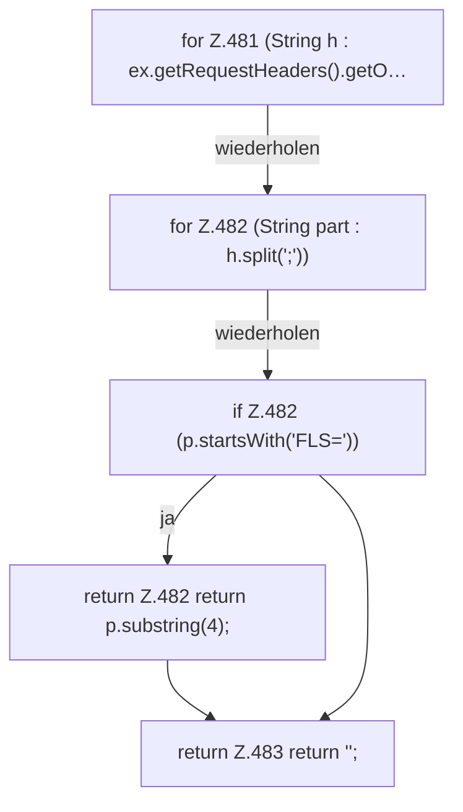

[[00 Start]] › [[Dashboard-HTTP]] › [[HTTP-Auth]] › [[Dashboard.token]]

# Dashboard.token

`Dashboard.token(HttpExchange ex)` [src/main/java/de/aichele/childlauncher/Dashboard.java:480–484](https://github.com/Sciddie/minecraft-serverhoster-plugin/blob/95b02b953b0b4c23673e900e021a7c3c844aa37d/src/main/java/de/aichele/childlauncher/Dashboard.java#L480-L484)



```knoten
for Z.481 (String h : ex.getRequestHeaders().getO…
  Dasselbe wird für jeden Eintrag wiederholt. Das steht in [[Glossar#Zeile|Zeile]] 481.
for Z.482 (String part : h.split(';'))
  Dasselbe wird für jeden Eintrag wiederholt. Das steht in [[Glossar#Zeile|Zeile]] 482.
if Z.482 (p.startsWith('FLS='))
  Hier fällt eine Entscheidung. Nur wenn sie zutrifft, geht es den Ja-Weg weiter. Das steht in [[Glossar#Zeile|Zeile]] 482.
return Z.482 return p.substring(4);
  Hier endet die [[Glossar#Funktion|Funktion]] und liefert ein Ergebnis zurück. Das steht in [[Glossar#Zeile|Zeile]] 482.
return Z.483 return '';
  Hier endet die [[Glossar#Funktion|Funktion]] und liefert ein Ergebnis zurück. Das steht in [[Glossar#Zeile|Zeile]] 483.
```

> [!knoten]- Was die Blöcke tun
> - **for Z.481 (String h : ex.getRequestHeaders().getO…**: Dasselbe wird für jeden Eintrag wiederholt. Das steht in [[Glossar#Zeile|Zeile]] 481.
> - **for Z.482 (String part : h.split(';'))**: Dasselbe wird für jeden Eintrag wiederholt. Das steht in [[Glossar#Zeile|Zeile]] 482.
> - **if Z.482 (p.startsWith('FLS='))**: Hier fällt eine Entscheidung. Nur wenn sie zutrifft, geht es den Ja-Weg weiter. Das steht in [[Glossar#Zeile|Zeile]] 482.
> - **return Z.482 return p.substring(4);**: Hier endet die [[Glossar#Funktion|Funktion]] und liefert ein Ergebnis zurück. Das steht in [[Glossar#Zeile|Zeile]] 482.
> - **return Z.483 return '';**: Hier endet die [[Glossar#Funktion|Funktion]] und liefert ein Ergebnis zurück. Das steht in [[Glossar#Zeile|Zeile]] 483.

- Die [[Glossar#Web-Schnittstelle|Web-Schnittstelle]] macht hier einen einzelnen Schritt. Eine Ebene tiefer steht er genauer.
