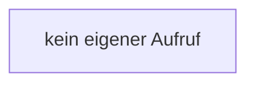

[[00 Start]] › [[Dashboard-HTTP]] › [[HTTP-Klassen]] › [[DashboardPassword]] › [[DashboardPassword.DashboardPassword]]

# DashboardPassword.DashboardPassword

`DashboardPassword.DashboardPassword()` [src/main/java/de/aichele/childlauncher/DashboardPassword.java:12–12](https://github.com/Sciddie/minecraft-serverhoster-plugin/blob/95b02b953b0b4c23673e900e021a7c3c844aa37d/src/main/java/de/aichele/childlauncher/DashboardPassword.java#L12-L12)



```knoten
kein eigener Aufruf
  In diesem Stück gibt es keinen weiteren eigenen Aufruf.
```

- `DashboardPassword` in `src/main/java/de/aichele/childlauncher/DashboardPassword.java`
