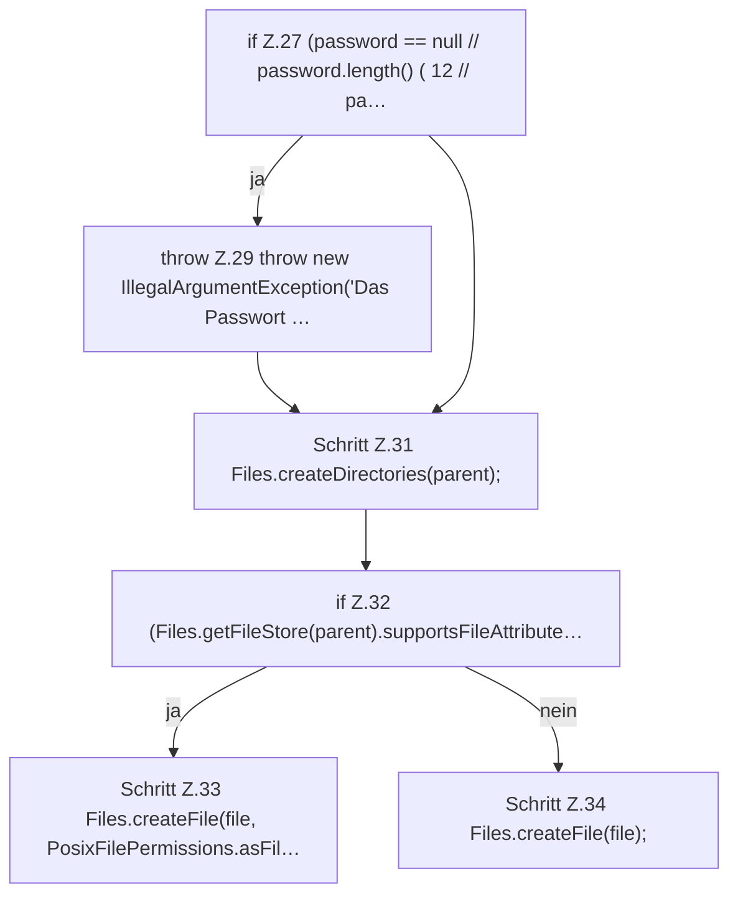

[[00 Start]] › [[Dashboard-HTTP]] › [[HTTP-Klassen]] › [[DashboardPassword]] › [[DashboardPassword.create]] › [[DashboardPassword.create.Teil1]]

# DashboardPassword.create.Teil1

- Fortsetzung von `DashboardPassword.create`, Quellreihenfolge.
