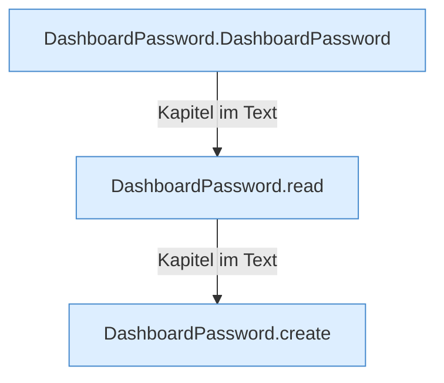

[[00 Start]] › [[Dashboard-HTTP]] › [[HTTP-Klassen]] › [[DashboardPassword]]

# DashboardPassword



```knoten
DashboardPassword.DashboardPassword
  Dieser Teil kümmert sich um das Passwort. Im [[Glossar#Quelltext|Quelltext]] heißt das `DashboardPassword`.
DashboardPassword.read
  Dieser Teil liest das. Im [[Glossar#Quelltext|Quelltext]] heißt das `read`.
DashboardPassword.create
  Dieser Teil legt an das. Im [[Glossar#Quelltext|Quelltext]] heißt das `create`.
```

> [!knoten]- Was die Blöcke tun
> - **DashboardPassword.DashboardPassword**: Dieser Teil kümmert sich um das Passwort. Im [[Glossar#Quelltext|Quelltext]] heißt das `DashboardPassword`.
> - **DashboardPassword.read**: Dieser Teil liest das. Im [[Glossar#Quelltext|Quelltext]] heißt das `read`.
> - **DashboardPassword.create**: Dieser Teil legt an das. Im [[Glossar#Quelltext|Quelltext]] heißt das `create`.

- Prüft das Passwort der [[Glossar#Bedienseite|Bedienseite]] und merkt sich die [[Glossar#Anmeldung|Anmeldung]].
