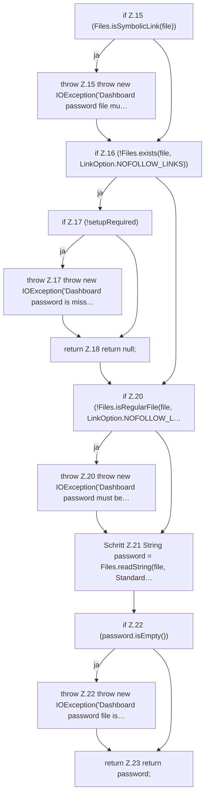

[[00 Start]] › [[Dashboard-HTTP]] › [[HTTP-Klassen]] › [[DashboardPassword]] › [[DashboardPassword.read]]

# DashboardPassword.read

`DashboardPassword.read(Path file, boolean setupRequired)` [src/main/java/de/aichele/childlauncher/DashboardPassword.java:14–24](https://github.com/Sciddie/minecraft-serverhoster-plugin/blob/95b02b953b0b4c23673e900e021a7c3c844aa37d/src/main/java/de/aichele/childlauncher/DashboardPassword.java#L14-L24)

- `read` in `src/main/java/de/aichele/childlauncher/DashboardPassword.java`
