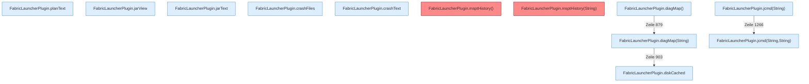

[[00 Start]] › [[Plugin-Kern]] › [[Diagnose]]

# Diagnose



```knoten
FabricLauncherPlugin.planText
  Schreibt den [[Glossar#Startplan|Startplan]] als lesbaren Text.
FabricLauncherPlugin.jarView
  Zeigt, welche [[Glossar#Programmdatei|Programmdatei]] der [[Glossar#Spielserver|Spielserver]] benutzt.
FabricLauncherPlugin.jarText
  Zeigt Einzelheiten aus der [[Glossar#Programmdatei|Programmdatei]].
FabricLauncherPlugin.crashFiles
  Listet die [[Glossar#Absturzbericht|Absturzberichte]].
FabricLauncherPlugin.crashText
  Zeigt den Text eines [[Glossar#Absturzbericht|Absturzberichts]].
FabricLauncherPlugin.msptHistory()
  Liefert den Verlauf, wie lange ein [[Glossar#Spielschritt|Spielschritt]] jeweils gedauert hat. Auffällig: im normalen Betrieb ruft das niemand auf. Das nennt man [[Glossar#Ungenutzt|Ungenutzt]].
FabricLauncherPlugin.msptHistory(String)
  Liefert den Verlauf, wie lange ein [[Glossar#Spielschritt|Spielschritt]] jeweils gedauert hat. Auffällig: im normalen Betrieb ruft das niemand auf. Das nennt man [[Glossar#Ungenutzt|Ungenutzt]].
FabricLauncherPlugin.diskCached
  Sagt, wie voll die Festplatte ist. Der Wert darf kurz zwischengespeichert sein.
FabricLauncherPlugin.diagMap()
  Sammelt die [[Glossar#Diagnose|Diagnose]] in einer Übersicht.
FabricLauncherPlugin.diagMap(String)
  Sammelt die [[Glossar#Diagnose|Diagnose]] in einer Übersicht.
FabricLauncherPlugin.jcmd(String)
  Fragt ein Hilfswerkzeug von Java, wie es dem laufenden Programm geht.
FabricLauncherPlugin.jcmd(String,String)
  Fragt ein Hilfswerkzeug von Java, wie es dem laufenden Programm geht.
```

> [!knoten] Was die Blöcke tun
> - **FabricLauncherPlugin.planText**: Schreibt den [[Glossar#Startplan|Startplan]] als lesbaren Text.
> - **FabricLauncherPlugin.jarView**: Zeigt, welche [[Glossar#Programmdatei|Programmdatei]] der [[Glossar#Spielserver|Spielserver]] benutzt.
> - **FabricLauncherPlugin.jarText**: Zeigt Einzelheiten aus der [[Glossar#Programmdatei|Programmdatei]].
> - **FabricLauncherPlugin.crashFiles**: Listet die [[Glossar#Absturzbericht|Absturzberichte]].
> - **FabricLauncherPlugin.crashText**: Zeigt den Text eines [[Glossar#Absturzbericht|Absturzberichts]].
> - **FabricLauncherPlugin.msptHistory()**: Liefert den Verlauf, wie lange ein [[Glossar#Spielschritt|Spielschritt]] jeweils gedauert hat. Auffällig: im normalen Betrieb ruft das niemand auf. Das nennt man [[Glossar#Ungenutzt|Ungenutzt]].
> - **FabricLauncherPlugin.msptHistory(String)**: Liefert den Verlauf, wie lange ein [[Glossar#Spielschritt|Spielschritt]] jeweils gedauert hat. Auffällig: im normalen Betrieb ruft das niemand auf. Das nennt man [[Glossar#Ungenutzt|Ungenutzt]].
> - **FabricLauncherPlugin.diskCached**: Sagt, wie voll die Festplatte ist. Der Wert darf kurz zwischengespeichert sein.
> - **FabricLauncherPlugin.diagMap()**: Sammelt die [[Glossar#Diagnose|Diagnose]] in einer Übersicht.
> - **FabricLauncherPlugin.diagMap(String)**: Sammelt die [[Glossar#Diagnose|Diagnose]] in einer Übersicht.
> - **FabricLauncherPlugin.jcmd(String)**: Fragt ein Hilfswerkzeug von Java, wie es dem laufenden Programm geht.
> - **FabricLauncherPlugin.jcmd(String,String)**: Fragt ein Hilfswerkzeug von Java, wie es dem laufenden Programm geht.

- Eine Übersicht zum Nachsehen: Platte, [[Glossar#Startplan|Startplan]], [[Glossar#Programmdatei|Programmdatei]], [[Glossar#Absturzbericht|Absturzberichte]] und die Dauer der [[Glossar#Spielschritt|Spielschritte]].
