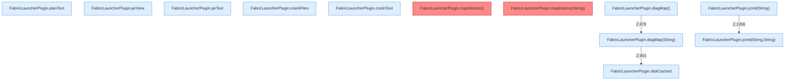

[[00 Start]] › [[Plugin-Kern]] › [[Diagnose]]

# Diagnose



```knoten
FabricLauncherPlugin.planText
  Zeigt den Startplan `planText`. Ruft `text`, `javaBin`, `profile`.
FabricLauncherPlugin.jarView
  Betrifft das Jar `jarView`. Ruft `view`, `inspect`, `profile`.
FabricLauncherPlugin.jarText
  Betrifft das Jar `jarText`. Ruft `text`, `inspect`, `profile`.
FabricLauncherPlugin.crashFiles
  Betrifft Crash-Reports `crashFiles`. Ruft `list`, `profile`, `directory`.
FabricLauncherPlugin.crashText
  Betrifft Crash-Reports `crashText`. Ruft `read`, `profile`, `directory`.
FabricLauncherPlugin.msptHistory()
  Liefert die Tickzeiten `msptHistory`. Ruft `focusSlot`, `msptHistory`. Befund: toter Code (prüfen).
FabricLauncherPlugin.msptHistory(String)
  Liefert die Tickzeiten `msptHistory`. Ruft `slot`, `msptHistory`. Befund: toter Code (prüfen).
FabricLauncherPlugin.diskCached
  Liest die Platte `diskCached`. Ruft `disk`, `workDir`.
FabricLauncherPlugin.diagMap()
  Sammelt die Diagnose `diagMap`. Ruft `diagMap`.
FabricLauncherPlugin.diagMap(String)
  Sammelt die Diagnose `diagMap`. Ruft `slot`, `pid`, `running`.
FabricLauncherPlugin.jcmd(String)
  `jcmd` in `FabricLauncherPlugin.java`. Ruft `jcmd`.
FabricLauncherPlugin.jcmd(String,String)
  `jcmd` in `FabricLauncherPlugin.java`. Ruft `jcmd`, `slot`, `pid`.
```


