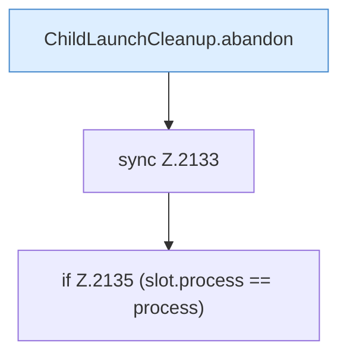

[[00 Start]] › [[Child-Prozess]] › [[Startablauf]] › [[FabricLauncherPlugin.abandonFailedStart]] › [[FabricLauncherPlugin.abandonFailedStart.Teil1]]

# FabricLauncherPlugin.abandonFailedStart.Teil1



```knoten
ChildLaunchCleanup.abandon
  Bricht den fehlgeschlagenen Start ab `abandon`.
sync Z.2133
  Zeile 2133: synchronisierter Block.
if Z.2135 (slot.process == process)
  Zeile 2135: prüft `(slot.process == process)`.
```

- Fortsetzung von `FabricLauncherPlugin.abandonFailedStart`, Quellreihenfolge.
