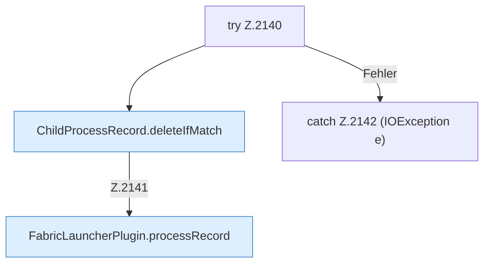

[[00 Start]] › [[Child-Prozess]] › [[Startablauf]] › [[FabricLauncherPlugin.abandonFailedStart]] › [[FabricLauncherPlugin.abandonFailedStart.Teil2]]

# FabricLauncherPlugin.abandonFailedStart.Teil2



```knoten
try Z.2140
  Zeile 2140: Versuch. Der Fehlerpfad geht in catch.
ChildProcessRecord.deleteIfMatch
  Löscht `deleteIfMatch`. Ruft `read`.
FabricLauncherPlugin.processRecord
  `processRecord` in `FabricLauncherPlugin.java`.
catch Z.2142 (IOException e)
  Zeile 2142: fängt (IOException e).
```

- Fortsetzung von `FabricLauncherPlugin.abandonFailedStart`, Quellreihenfolge.
