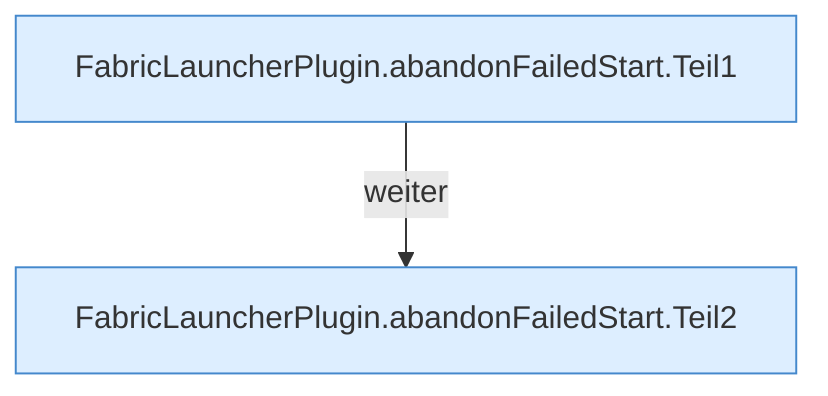

[[00 Start]] › [[Child-Prozess]] › [[Startablauf]] › [[FabricLauncherPlugin.abandonFailedStart]]

# FabricLauncherPlugin.abandonFailedStart

`FabricLauncherPlugin.abandonFailedStart(ChildSlot slot, Process process)` [src/main/java/de/aichele/childlauncher/FabricLauncherPlugin.java:2130–2145](https://github.com/Sciddie/minecraft-serverhoster-plugin/blob/95b02b953b0b4c23673e900e021a7c3c844aa37d/src/main/java/de/aichele/childlauncher/FabricLauncherPlugin.java#L2130-L2145)

- `abandonFailedStart` in `src/main/java/de/aichele/childlauncher/FabricLauncherPlugin.java`
