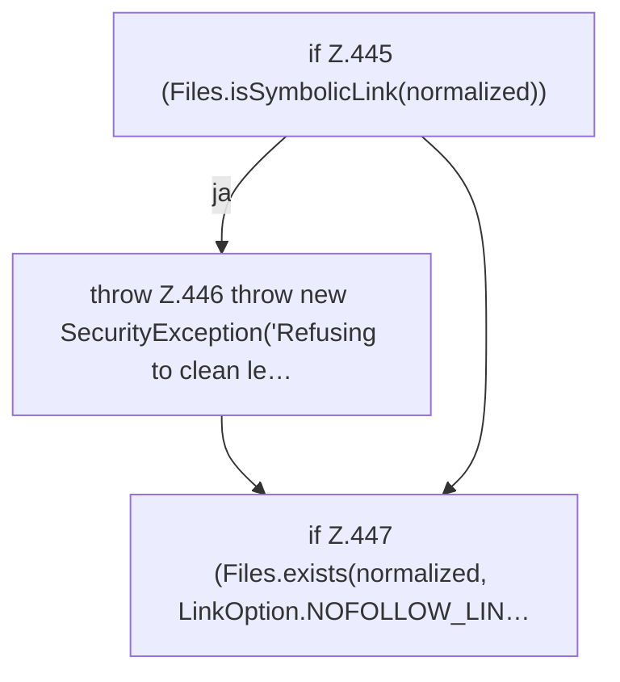

[[00 Start]] › [[Plugin-Kern]] › [[Setup]] › [[Setup-Aufraeumen]] › [[FabricLauncherPlugin.addLegacyDataToPreserve]]

# FabricLauncherPlugin.addLegacyDataToPreserve

`FabricLauncherPlugin.addLegacyDataToPreserve(Set<Path> preserved, Path path)` [src/main/java/de/aichele/childlauncher/FabricLauncherPlugin.java:443–448](https://github.com/Sciddie/minecraft-serverhoster-plugin/blob/95b02b953b0b4c23673e900e021a7c3c844aa37d/src/main/java/de/aichele/childlauncher/FabricLauncherPlugin.java#L443-L448)



```knoten
if Z.445 (Files.isSymbolicLink(normalized))
  Zeile 445: prüft `(Files.isSymbolicLink(normalized))`.
throw Z.446 throw new SecurityException('Refusing to clean le…
  Zeile 446: Abbruch `throw new SecurityException('Refusing to clean le…`.
if Z.447 (Files.exists(normalized, LinkOption.NOFOLLOW_LIN…
  Zeile 447: prüft `(Files.exists(normalized, LinkOption.NOFOLLOW_LIN…`.
```

> [!knoten]- Was die Blöcke tun
> - **if Z.445 (Files.isSymbolicLink(normalized))**: Zeile 445: prüft `(Files.isSymbolicLink(normalized))`.
> - **throw Z.446 throw new SecurityException('Refusing to clean le…**: Zeile 446: Abbruch `throw new SecurityException('Refusing to clean le…`.
> - **if Z.447 (Files.exists(normalized, LinkOption.NOFOLLOW_LIN…**: Zeile 447: prüft `(Files.exists(normalized, LinkOption.NOFOLLOW_LIN…`.

- Das [[Glossar#Plugin|Plugin]] fügt hinzu den alten Weg.
- `addLegacyDataToPreserve` in `src/main/java/de/aichele/childlauncher/FabricLauncherPlugin.java`
