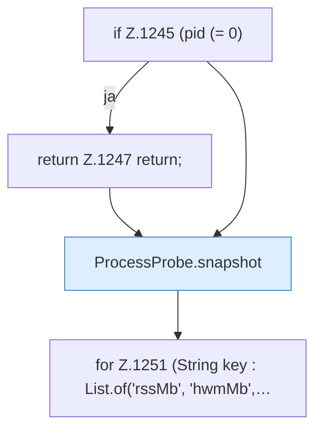

[[00 Start]] › [[Host-Betrieb]] › [[Speicher-Probe]] › [[FabricLauncherPlugin.addProcessDiagnostics]] › [[FabricLauncherPlugin.addProcessDiagnostics.Teil1]]

# FabricLauncherPlugin.addProcessDiagnostics.Teil1

- Fortsetzung von `FabricLauncherPlugin.addProcessDiagnostics`, Quellreihenfolge.
