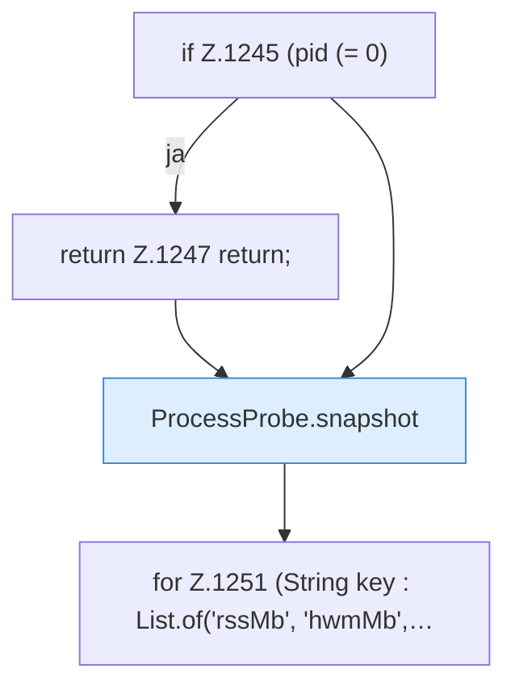

[[00 Start]] › [[Host-Betrieb]] › [[Speicher-Probe]] › [[FabricLauncherPlugin.addProcessDiagnostics]] › [[FabricLauncherPlugin.addProcessDiagnostics.Teil1]]

# FabricLauncherPlugin.addProcessDiagnostics.Teil1



```knoten
if Z.1245 (pid (= 0)
  Zeile 1245: prüft `(pid (= 0)`.
return Z.1247 return;
  Zeile 1247: Rückgabe `return;`.
ProcessProbe.snapshot
  Dieser Teil macht hier einen einzelnen Schritt. Eine Ebene tiefer steht er genauer. `snapshot` in `ProcessProbe.java`. Ruft `kb`.
for Z.1251 (String key : List.of('rssMb', 'hwmMb',…
  Zeile 1251: Schleife `(String key : List.of('rssMb', 'hwmMb',…`.
```

> [!knoten]- Was die Blöcke tun
> - **if Z.1245 (pid (= 0)**: Zeile 1245: prüft `(pid (= 0)`.
> - **return Z.1247 return;**: Zeile 1247: Rückgabe `return;`.
> - **ProcessProbe.snapshot**: Dieser Teil macht hier einen einzelnen Schritt. Eine Ebene tiefer steht er genauer. `snapshot` in `ProcessProbe.java`. Ruft `kb`.
> - **for Z.1251 (String key : List.of('rssMb', 'hwmMb',…**: Zeile 1251: Schleife `(String key : List.of('rssMb', 'hwmMb',…`.

- Ein weiterer Abschnitt derselben Übersicht.
- Fortsetzung von `FabricLauncherPlugin.addProcessDiagnostics`.
