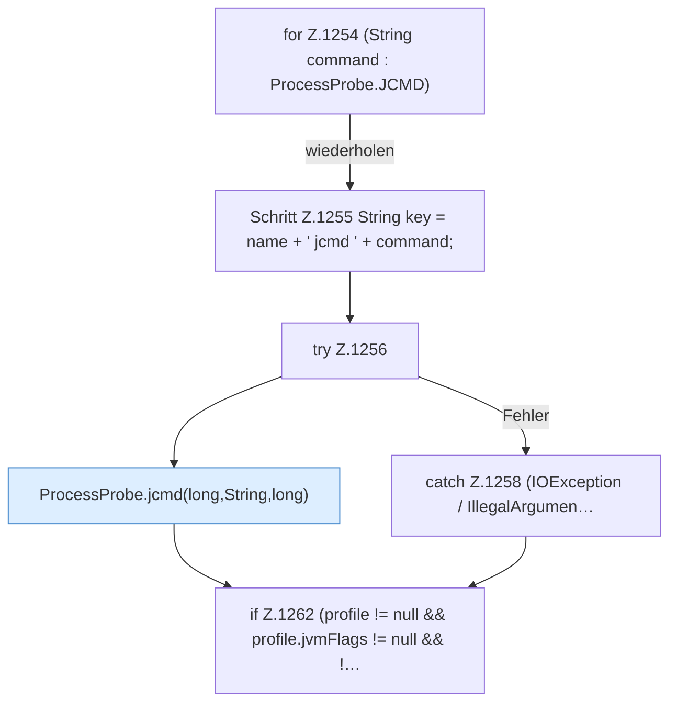

[[00 Start]] › [[Host-Betrieb]] › [[Speicher-Probe]] › [[FabricLauncherPlugin.addProcessDiagnostics]] › [[FabricLauncherPlugin.addProcessDiagnostics.Teil2]]

# FabricLauncherPlugin.addProcessDiagnostics.Teil2



```knoten
for Z.1254 (String command : ProcessProbe.JCMD)
  Zeile 1254: Schleife `(String command : ProcessProbe.JCMD)`.
Schritt Z.1255 String key = name + ' jcmd ' + command;
  Zeile 1255: fragt jcmd. `String key = name + ' jcmd ' + command;`
try Z.1256
  Zeile 1256: Versuch. Der Fehlerpfad geht in catch.
ProcessProbe.jcmd(long,String,long)
  Dieser Teil macht hier einen einzelnen Schritt. Eine Ebene tiefer steht er genauer. `jcmd` in `ProcessProbe.java`. Ruft `abbreviate`.
catch Z.1258 (IOException / IllegalArgumen…
  Zeile 1258: fängt (IOException / IllegalArgumen….
if Z.1262 (profile != null && profile.jvmFlags != null && !…
  Zeile 1262: prüft `(profile != null && profile.jvmFlags != null && !…`.
```

> [!knoten]- Was die Blöcke tun
> - **for Z.1254 (String command : ProcessProbe.JCMD)**: Zeile 1254: Schleife `(String command : ProcessProbe.JCMD)`.
> - **Schritt Z.1255 String key = name + ' jcmd ' + command;**: Zeile 1255: fragt jcmd. `String key = name + ' jcmd ' + command;`
> - **try Z.1256**: Zeile 1256: Versuch. Der Fehlerpfad geht in catch.
> - **ProcessProbe.jcmd(long,String,long)**: Dieser Teil macht hier einen einzelnen Schritt. Eine Ebene tiefer steht er genauer. `jcmd` in `ProcessProbe.java`. Ruft `abbreviate`.
> - **catch Z.1258 (IOException / IllegalArgumen…**: Zeile 1258: fängt (IOException / IllegalArgumen….
> - **if Z.1262 (profile != null && profile.jvmFlags != null && !…**: Zeile 1262: prüft `(profile != null && profile.jvmFlags != null && !…`.

- Ein weiterer Abschnitt derselben Übersicht.
- Fortsetzung von `FabricLauncherPlugin.addProcessDiagnostics`.
