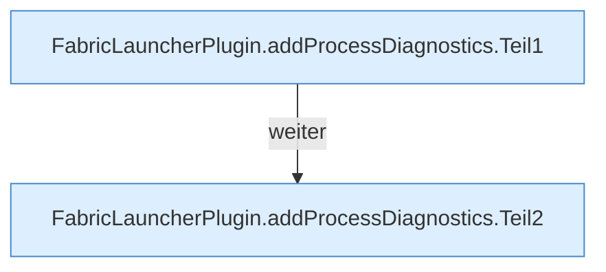

[[00 Start]] › [[Host-Betrieb]] › [[Speicher-Probe]] › [[FabricLauncherPlugin.addProcessDiagnostics]]

# FabricLauncherPlugin.addProcessDiagnostics

`FabricLauncherPlugin.addProcessDiagnostics(Map<String, String> diagnostics, String name, long pid, ServerProfile profile)` [src/main/java/de/aichele/childlauncher/FabricLauncherPlugin.java:1244–1264](https://github.com/Sciddie/minecraft-serverhoster-plugin/blob/95b02b953b0b4c23673e900e021a7c3c844aa37d/src/main/java/de/aichele/childlauncher/FabricLauncherPlugin.java#L1244-L1264)



```knoten
FabricLauncherPlugin.addProcessDiagnostics.Teil1
  Ein weiterer Abschnitt derselben Übersicht. Im [[Glossar#Quelltext|Quelltext]] heißt das `Teil1`.
FabricLauncherPlugin.addProcessDiagnostics.Teil2
  Ein weiterer Abschnitt derselben Übersicht. Im [[Glossar#Quelltext|Quelltext]] heißt das `Teil2`.
```

> [!knoten]- Was die Blöcke tun
> - **FabricLauncherPlugin.addProcessDiagnostics.Teil1**: Ein weiterer Abschnitt derselben Übersicht. Im [[Glossar#Quelltext|Quelltext]] heißt das `Teil1`.
> - **FabricLauncherPlugin.addProcessDiagnostics.Teil2**: Ein weiterer Abschnitt derselben Übersicht. Im [[Glossar#Quelltext|Quelltext]] heißt das `Teil2`.

- Das [[Glossar#Plugin|Plugin]] fügt hinzu das laufende Programm die [[Glossar#Diagnose|Diagnose]].
