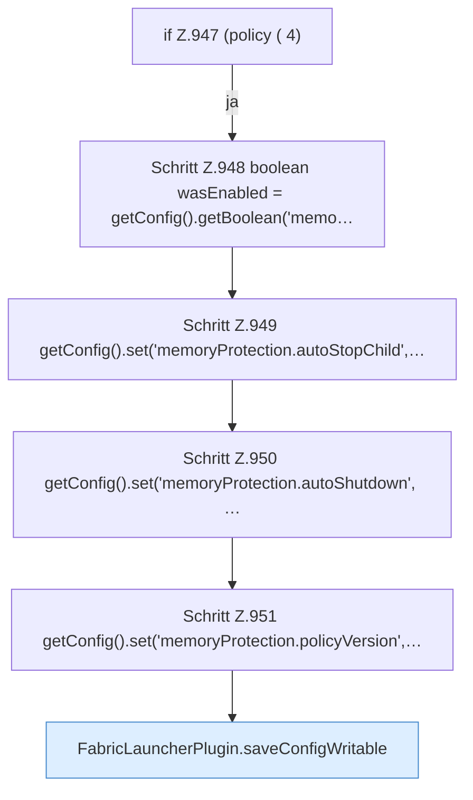

[[00 Start]] › [[Host-Betrieb]] › [[Speicher-Stopp]] › [[FabricLauncherPlugin.applyCurrentMemorySettings]] › [[FabricLauncherPlugin.applyCurrentMemorySettings.Teil1.Z946.Z947]]

# FabricLauncherPlugin.applyCurrentMemorySettings.Teil1.Z946.Z947



```knoten
if Z.947 (policy ( 4)
  Zeile 947: prüft `(policy ( 4)`.
Schritt Z.948 boolean wasEnabled = getConfig().getBoolean('memo…
  Zeile 948: liest die Config. `boolean wasEnabled = getConfig().getBoolean('memo…`
Schritt Z.949 getConfig().set('memoryProtection.autoStopChild',…
  Zeile 949: liest die Config. `getConfig().set('memoryProtection.autoStopChild',…`
Schritt Z.950 getConfig().set('memoryProtection.autoShutdown', …
  Zeile 950: liest die Config. `getConfig().set('memoryProtection.autoShutdown', …`
Schritt Z.951 getConfig().set('memoryProtection.policyVersion',…
  Zeile 951: liest die Config. `getConfig().set('memoryProtection.policyVersion',…`
FabricLauncherPlugin.saveConfigWritable
  Speichert `saveConfigWritable`. Ruft `makeWritable`.
```

- Fortsetzung von `FabricLauncherPlugin.applyCurrentMemorySettings.Teil1.Z946`, Quellreihenfolge.
