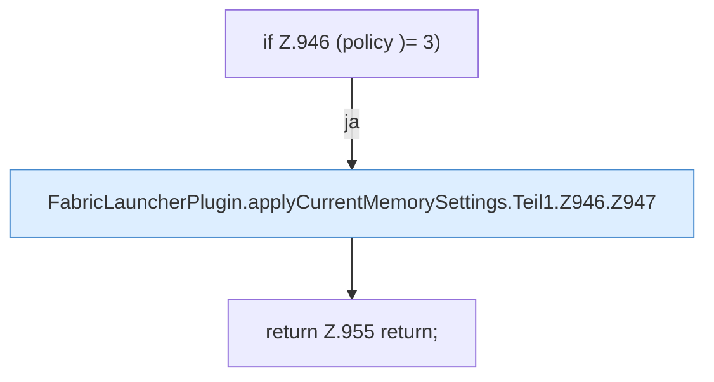

[[00 Start]] › [[Host-Betrieb]] › [[Speicher-Stopp]] › [[FabricLauncherPlugin.applyCurrentMemorySettings]] › [[FabricLauncherPlugin.applyCurrentMemorySettings.Teil1.Z946]]

# FabricLauncherPlugin.applyCurrentMemorySettings.Teil1.Z946

- Fortsetzung von `FabricLauncherPlugin.applyCurrentMemorySettings.Teil1`, Quellreihenfolge.
