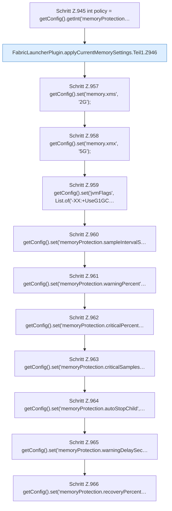

[[00 Start]] › [[Host-Betrieb]] › [[Speicher-Stopp]] › [[FabricLauncherPlugin.applyCurrentMemorySettings]] › [[FabricLauncherPlugin.applyCurrentMemorySettings.Teil1]]

# FabricLauncherPlugin.applyCurrentMemorySettings.Teil1



```knoten
Schritt Z.945 int policy = getConfig().getInt('memoryProtection…
  Zeile 945: liest die Config. `int policy = getConfig().getInt('memoryProtection…`
FabricLauncherPlugin.applyCurrentMemorySettings.Teil1.Z946
  Fortsetzung des Ablaufs ab Zeile 946.
Schritt Z.957 getConfig().set('memory.xms', '2G');
  Zeile 957: liest die Config. `getConfig().set('memory.xms', '2G');`
Schritt Z.958 getConfig().set('memory.xmx', '5G');
  Zeile 958: liest die Config. `getConfig().set('memory.xmx', '5G');`
Schritt Z.959 getConfig().set('jvmFlags', List.of('-XX:+UseG1GC…
  Zeile 959: liest die Config. `getConfig().set('jvmFlags', List.of('-XX:+UseG1GC…`
Schritt Z.960 getConfig().set('memoryProtection.sampleIntervalS…
  Zeile 960: liest die Config. `getConfig().set('memoryProtection.sampleIntervalS…`
Schritt Z.961 getConfig().set('memoryProtection.warningPercent'…
  Zeile 961: liest die Config. `getConfig().set('memoryProtection.warningPercent'…`
Schritt Z.962 getConfig().set('memoryProtection.criticalPercent…
  Zeile 962: liest die Config. `getConfig().set('memoryProtection.criticalPercent…`
Schritt Z.963 getConfig().set('memoryProtection.criticalSamples…
  Zeile 963: liest die Config. `getConfig().set('memoryProtection.criticalSamples…`
Schritt Z.964 getConfig().set('memoryProtection.autoStopChild',…
  Zeile 964: liest die Config. `getConfig().set('memoryProtection.autoStopChild',…`
Schritt Z.965 getConfig().set('memoryProtection.warningDelaySec…
  Zeile 965: liest die Config. `getConfig().set('memoryProtection.warningDelaySec…`
Schritt Z.966 getConfig().set('memoryProtection.recoveryPercent…
  Zeile 966: liest die Config. `getConfig().set('memoryProtection.recoveryPercent…`
```

- Fortsetzung von `FabricLauncherPlugin.applyCurrentMemorySettings`, Quellreihenfolge.
