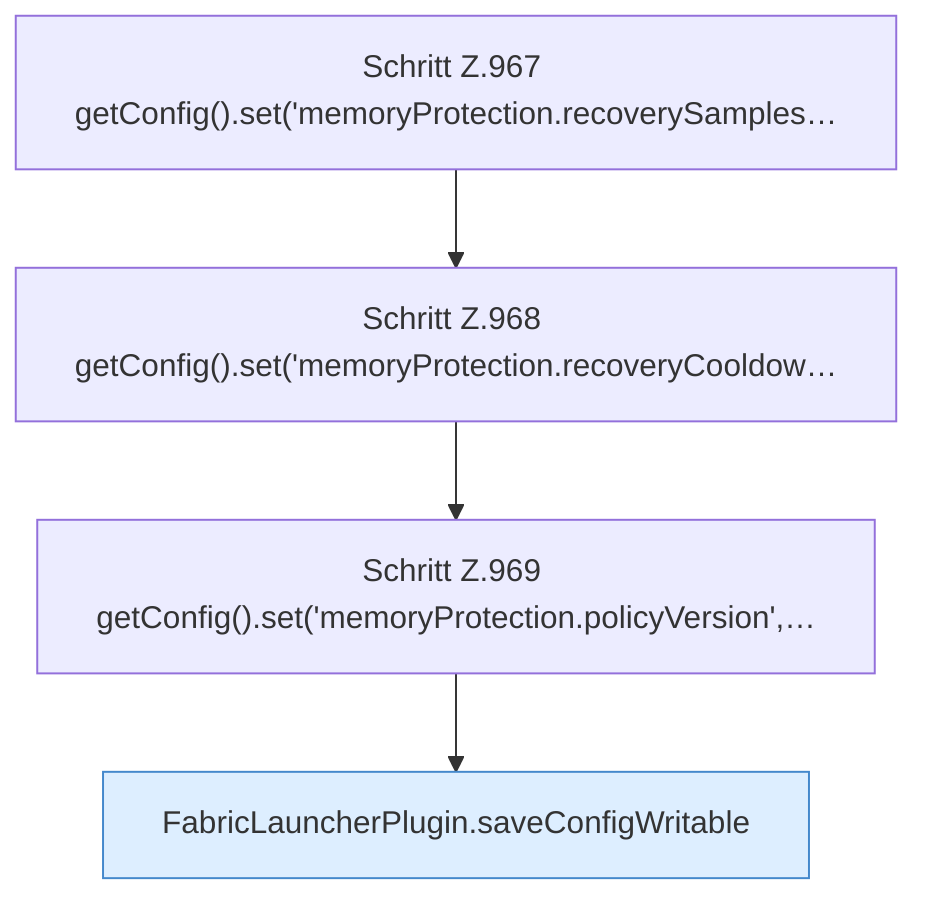

[[00 Start]] › [[Host-Betrieb]] › [[Speicher-Stopp]] › [[FabricLauncherPlugin.applyCurrentMemorySettings]] › [[FabricLauncherPlugin.applyCurrentMemorySettings.Teil2]]

# FabricLauncherPlugin.applyCurrentMemorySettings.Teil2

- Fortsetzung von `FabricLauncherPlugin.applyCurrentMemorySettings`, Quellreihenfolge.
