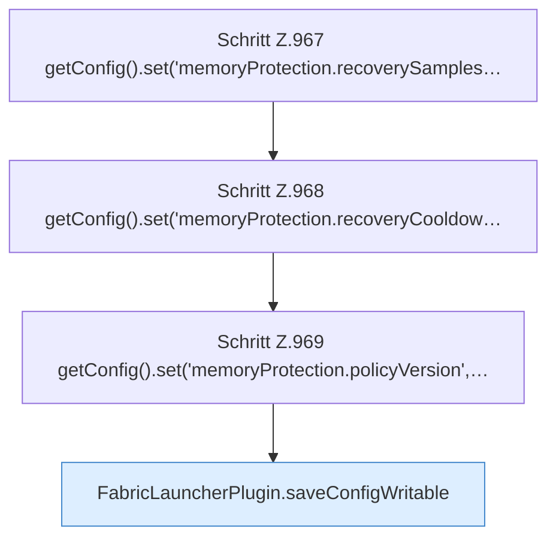

[[00 Start]] › [[Host-Betrieb]] › [[Speicher-Stopp]] › [[FabricLauncherPlugin.applyCurrentMemorySettings]] › [[FabricLauncherPlugin.applyCurrentMemorySettings.Teil2]]

# FabricLauncherPlugin.applyCurrentMemorySettings.Teil2



```knoten
Schritt Z.967 getConfig().set('memoryProtection.recoverySamples…
  Zeile 967: liest die Config. `getConfig().set('memoryProtection.recoverySamples…`
Schritt Z.968 getConfig().set('memoryProtection.recoveryCooldow…
  Zeile 968: liest die Config. `getConfig().set('memoryProtection.recoveryCooldow…`
Schritt Z.969 getConfig().set('memoryProtection.policyVersion',…
  Zeile 969: liest die Config. `getConfig().set('memoryProtection.policyVersion',…`
FabricLauncherPlugin.saveConfigWritable
  Speichert die [[Glossar#Einstellungsdatei|Einstellungsdatei]] und setzt danach die [[Glossar#Dateirechte|Dateirechte]] so, dass sie beschreibbar bleibt. Speichert `saveConfigWritable`. Ruft `makeWritable`.
```

> [!knoten]- Was die Blöcke tun
> - **Schritt Z.967 getConfig().set('memoryProtection.recoverySamples…**: Zeile 967: liest die Config. `getConfig().set('memoryProtection.recoverySamples…`
> - **Schritt Z.968 getConfig().set('memoryProtection.recoveryCooldow…**: Zeile 968: liest die Config. `getConfig().set('memoryProtection.recoveryCooldow…`
> - **Schritt Z.969 getConfig().set('memoryProtection.policyVersion',…**: Zeile 969: liest die Config. `getConfig().set('memoryProtection.policyVersion',…`
> - **FabricLauncherPlugin.saveConfigWritable**: Speichert die [[Glossar#Einstellungsdatei|Einstellungsdatei]] und setzt danach die [[Glossar#Dateirechte|Dateirechte]] so, dass sie beschreibbar bleibt. Speichert `saveConfigWritable`. Ruft `makeWritable`.

- Ein weiterer Abschnitt derselben Übersicht.
- Fortsetzung von `FabricLauncherPlugin.applyCurrentMemorySettings`.
