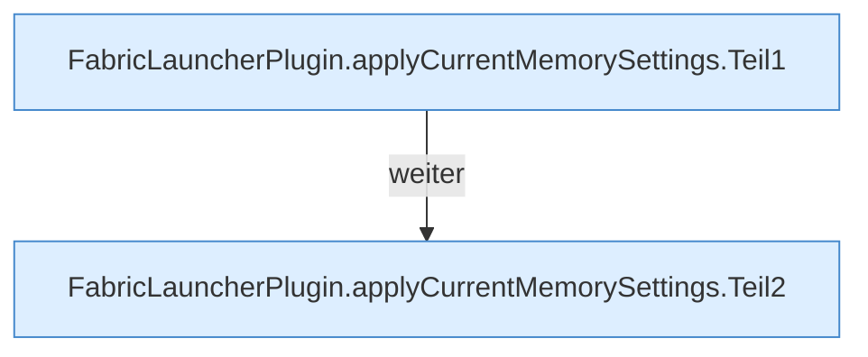

[[00 Start]] › [[Host-Betrieb]] › [[Speicher-Stopp]] › [[FabricLauncherPlugin.applyCurrentMemorySettings]]

# FabricLauncherPlugin.applyCurrentMemorySettings

`FabricLauncherPlugin.applyCurrentMemorySettings()` [src/main/java/de/aichele/childlauncher/FabricLauncherPlugin.java:944–972](https://github.com/Sciddie/minecraft-serverhoster-plugin/blob/95b02b953b0b4c23673e900e021a7c3c844aa37d/src/main/java/de/aichele/childlauncher/FabricLauncherPlugin.java#L944-L972)



```knoten
FabricLauncherPlugin.applyCurrentMemorySettings.Teil1
  Ein weiterer Abschnitt derselben Übersicht. Im [[Glossar#Quelltext|Quelltext]] heißt das `Teil1`.
FabricLauncherPlugin.applyCurrentMemorySettings.Teil2
  Ein weiterer Abschnitt derselben Übersicht. Im [[Glossar#Quelltext|Quelltext]] heißt das `Teil2`.
```

> [!knoten]- Was die Blöcke tun
> - **FabricLauncherPlugin.applyCurrentMemorySettings.Teil1**: Ein weiterer Abschnitt derselben Übersicht. Im [[Glossar#Quelltext|Quelltext]] heißt das `Teil1`.
> - **FabricLauncherPlugin.applyCurrentMemorySettings.Teil2**: Ein weiterer Abschnitt derselben Übersicht. Im [[Glossar#Quelltext|Quelltext]] heißt das `Teil2`.

- Das [[Glossar#Plugin|Plugin]] wendet an den aktuellen Stand den [[Glossar#Arbeitsspeicher|Arbeitsspeicher]] die [[Glossar#Einstellungen|Einstellungen]].
