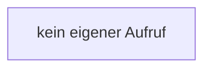

[[00 Start]] › [[Host-Betrieb]] › [[Host-Minimieren]] › [[Host-Minimieren.Teil2]] › [[FabricLauncherPlugin.applyLobbyRules]] › [[FabricLauncherPlugin.applyLobbyRules.keepSpawnInMemory]]

# FabricLauncherPlugin.applyLobbyRules.keepSpawnInMemory

`FabricLauncherPlugin.keepSpawnInMemory(boolean keep)` [src/main/java/de/aichele/childlauncher/FabricLauncherPlugin.java:2383–2383](https://github.com/Sciddie/minecraft-serverhoster-plugin/blob/95b02b953b0b4c23673e900e021a7c3c844aa37d/src/main/java/de/aichele/childlauncher/FabricLauncherPlugin.java#L2383-L2383)

- `keepSpawnInMemory` in `src/main/java/de/aichele/childlauncher/FabricLauncherPlugin.java`
