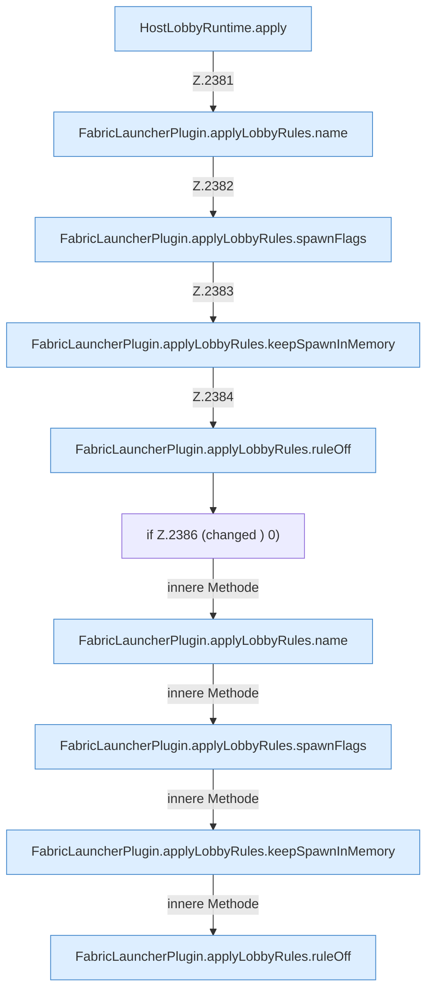

[[00 Start]] › [[Host-Betrieb]] › [[Host-Minimieren]] › [[Host-Minimieren.Teil2]] › [[FabricLauncherPlugin.applyLobbyRules]]

# FabricLauncherPlugin.applyLobbyRules

`FabricLauncherPlugin.applyLobbyRules(String lobby)` [src/main/java/de/aichele/childlauncher/FabricLauncherPlugin.java:2379–2387](https://github.com/Sciddie/minecraft-serverhoster-plugin/blob/95b02b953b0b4c23673e900e021a7c3c844aa37d/src/main/java/de/aichele/childlauncher/FabricLauncherPlugin.java#L2379-L2387)



```knoten
HostLobbyRuntime.apply
  Dieser Teil wendet an das. Wendet an `apply`. Ruft `worldNameSafe`.
FabricLauncherPlugin.applyLobbyRules.name
  Das [[Glossar#Plugin|Plugin]] macht hier einen einzelnen Schritt. Eine Ebene tiefer steht er genauer. `name` in `FabricLauncherPlugin.java`.
FabricLauncherPlugin.applyLobbyRules.spawnFlags
  Das [[Glossar#Plugin|Plugin]] macht hier einen einzelnen Schritt. Eine Ebene tiefer steht er genauer. `spawnFlags` in `FabricLauncherPlugin.java`.
FabricLauncherPlugin.applyLobbyRules.keepSpawnInMemory
  Das [[Glossar#Plugin|Plugin]] macht hier einen einzelnen Schritt. Eine Ebene tiefer steht er genauer. `keepSpawnInMemory` in `FabricLauncherPlugin.java`.
FabricLauncherPlugin.applyLobbyRules.ruleOff
  Das [[Glossar#Plugin|Plugin]] macht hier einen einzelnen Schritt. Eine Ebene tiefer steht er genauer. `ruleOff` in `FabricLauncherPlugin.java`.
if Z.2386 (changed ) 0)
  Zeile 2386: prüft `(changed ) 0)`.
```

> [!knoten]- Was die Blöcke tun
> - **HostLobbyRuntime.apply**: Dieser Teil wendet an das. Wendet an `apply`. Ruft `worldNameSafe`.
> - **FabricLauncherPlugin.applyLobbyRules.name**: Das [[Glossar#Plugin|Plugin]] macht hier einen einzelnen Schritt. Eine Ebene tiefer steht er genauer. `name` in `FabricLauncherPlugin.java`.
> - **FabricLauncherPlugin.applyLobbyRules.spawnFlags**: Das [[Glossar#Plugin|Plugin]] macht hier einen einzelnen Schritt. Eine Ebene tiefer steht er genauer. `spawnFlags` in `FabricLauncherPlugin.java`.
> - **FabricLauncherPlugin.applyLobbyRules.keepSpawnInMemory**: Das [[Glossar#Plugin|Plugin]] macht hier einen einzelnen Schritt. Eine Ebene tiefer steht er genauer. `keepSpawnInMemory` in `FabricLauncherPlugin.java`.
> - **FabricLauncherPlugin.applyLobbyRules.ruleOff**: Das [[Glossar#Plugin|Plugin]] macht hier einen einzelnen Schritt. Eine Ebene tiefer steht er genauer. `ruleOff` in `FabricLauncherPlugin.java`.
> - **if Z.2386 (changed ) 0)**: Zeile 2386: prüft `(changed ) 0)`.

- Das [[Glossar#Plugin|Plugin]] wendet an die Wartewelt.
- `applyLobbyRules` in `src/main/java/de/aichele/childlauncher/FabricLauncherPlugin.java`
