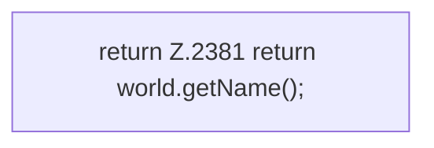

[[00 Start]] › [[Host-Betrieb]] › [[Host-Minimieren]] › [[Host-Minimieren.Teil2]] › [[FabricLauncherPlugin.applyLobbyRules]] › [[FabricLauncherPlugin.applyLobbyRules.name]]

# FabricLauncherPlugin.applyLobbyRules.name

`FabricLauncherPlugin.name()` [src/main/java/de/aichele/childlauncher/FabricLauncherPlugin.java:2381–2381](https://github.com/Sciddie/minecraft-serverhoster-plugin/blob/95b02b953b0b4c23673e900e021a7c3c844aa37d/src/main/java/de/aichele/childlauncher/FabricLauncherPlugin.java#L2381-L2381)

- `name` in `src/main/java/de/aichele/childlauncher/FabricLauncherPlugin.java`
