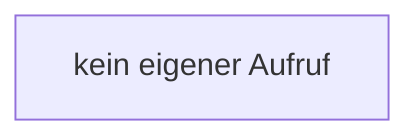

[[00 Start]] › [[Host-Betrieb]] › [[Host-Minimieren]] › [[Host-Minimieren.Teil2]] › [[FabricLauncherPlugin.applyLobbyRules]] › [[FabricLauncherPlugin.applyLobbyRules.ruleOff]]

# FabricLauncherPlugin.applyLobbyRules.ruleOff

`FabricLauncherPlugin.ruleOff(String name)` [src/main/java/de/aichele/childlauncher/FabricLauncherPlugin.java:2384–2384](https://github.com/Sciddie/minecraft-serverhoster-plugin/blob/95b02b953b0b4c23673e900e021a7c3c844aa37d/src/main/java/de/aichele/childlauncher/FabricLauncherPlugin.java#L2384-L2384)



```knoten
kein eigener Aufruf
  In diesem Stück gibt es keinen weiteren eigenen Aufruf.
```

> [!knoten]- Was die Blöcke tun
> - **kein eigener Aufruf**: In diesem Stück gibt es keinen weiteren eigenen Aufruf.

- Das [[Glossar#Plugin|Plugin]] macht hier einen einzelnen Schritt. Eine Ebene tiefer steht er genauer.
- `ruleOff` in `src/main/java/de/aichele/childlauncher/FabricLauncherPlugin.java`
