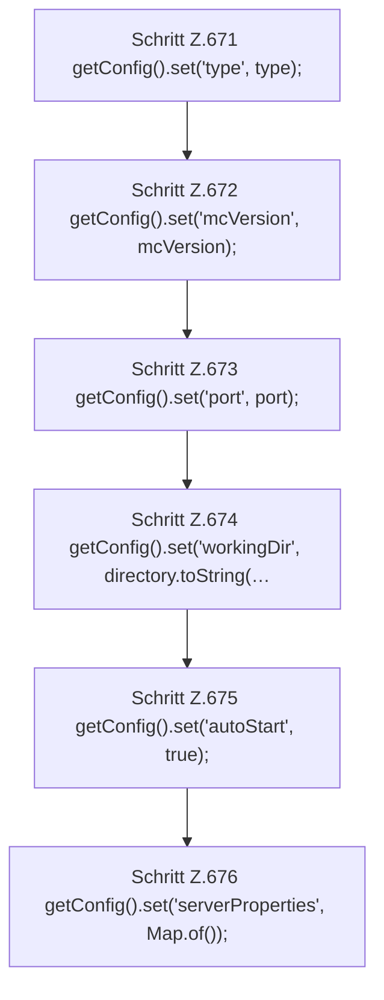

[[00 Start]] › [[Plugin-Kern]] › [[Setup]] › [[Setup-Dialog]] › [[FabricLauncherPlugin.applySetupProfile]]

# FabricLauncherPlugin.applySetupProfile

`FabricLauncherPlugin.applySetupProfile(Path directory, String type, String mcVersion, int port)` [src/main/java/de/aichele/childlauncher/FabricLauncherPlugin.java:670–677](https://github.com/Sciddie/minecraft-serverhoster-plugin/blob/95b02b953b0b4c23673e900e021a7c3c844aa37d/src/main/java/de/aichele/childlauncher/FabricLauncherPlugin.java#L670-L677)

- `applySetupProfile` in `src/main/java/de/aichele/childlauncher/FabricLauncherPlugin.java`
