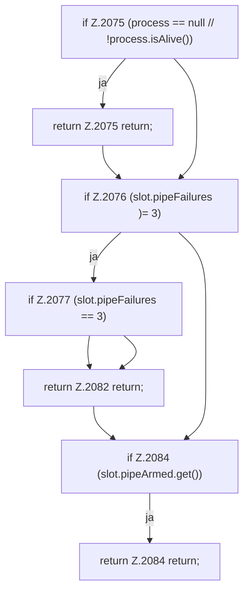

[[00 Start]] › [[Child-Prozess]] › [[Startablauf]] › [[FabricLauncherPlugin.armPipe]] › [[FabricLauncherPlugin.armPipe.Z2073.Teil1]]

# FabricLauncherPlugin.armPipe.Z2073.Teil1

- Fortsetzung von `FabricLauncherPlugin.armPipe.Z2073`, Quellreihenfolge.
