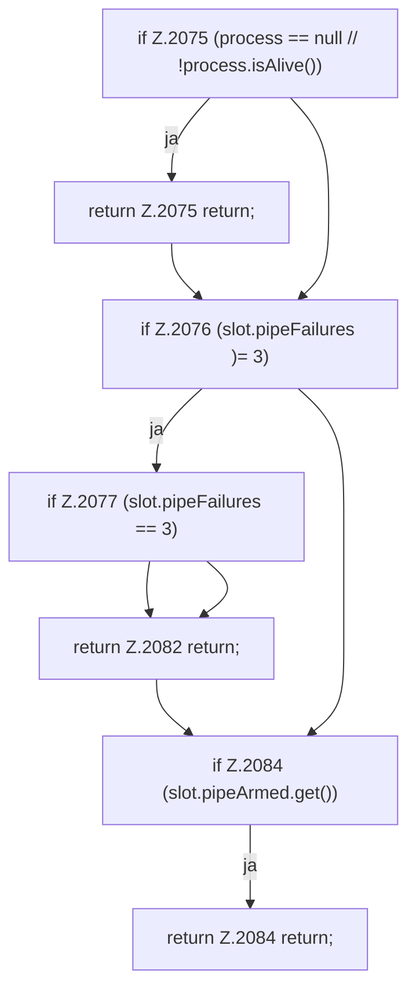

[[00 Start]] › [[Child-Prozess]] › [[Startablauf]] › [[FabricLauncherPlugin.armPipe]] › [[FabricLauncherPlugin.armPipe.Z2073.Teil1]]

# FabricLauncherPlugin.armPipe.Z2073.Teil1



```knoten
if Z.2075 (process == null // !process.isAlive())
  Zeile 2075: prüft `(process == null // !process.isAlive())`.
return Z.2075 return;
  Zeile 2075: Rückgabe `return;`.
if Z.2076 (slot.pipeFailures )= 3)
  Zeile 2076: prüft `(slot.pipeFailures )= 3)`.
if Z.2077 (slot.pipeFailures == 3)
  Zeile 2077: prüft `(slot.pipeFailures == 3)`.
return Z.2082 return;
  Zeile 2082: Rückgabe `return;`.
if Z.2084 (slot.pipeArmed.get())
  Zeile 2084: prüft `(slot.pipeArmed.get())`.
return Z.2084 return;
  Zeile 2084: Rückgabe `return;`.
```

> [!knoten]- Was die Blöcke tun
> - **if Z.2075 (process == null // !process.isAlive())**: Zeile 2075: prüft `(process == null // !process.isAlive())`.
> - **return Z.2075 return;**: Zeile 2075: Rückgabe `return;`.
> - **if Z.2076 (slot.pipeFailures )= 3)**: Zeile 2076: prüft `(slot.pipeFailures )= 3)`.
> - **if Z.2077 (slot.pipeFailures == 3)**: Zeile 2077: prüft `(slot.pipeFailures == 3)`.
> - **return Z.2082 return;**: Zeile 2082: Rückgabe `return;`.
> - **if Z.2084 (slot.pipeArmed.get())**: Zeile 2084: prüft `(slot.pipeArmed.get())`.
> - **return Z.2084 return;**: Zeile 2084: Rückgabe `return;`.

- Ein weiterer Abschnitt derselben Übersicht.
- Fortsetzung von `FabricLauncherPlugin.armPipe.Z2073`.
