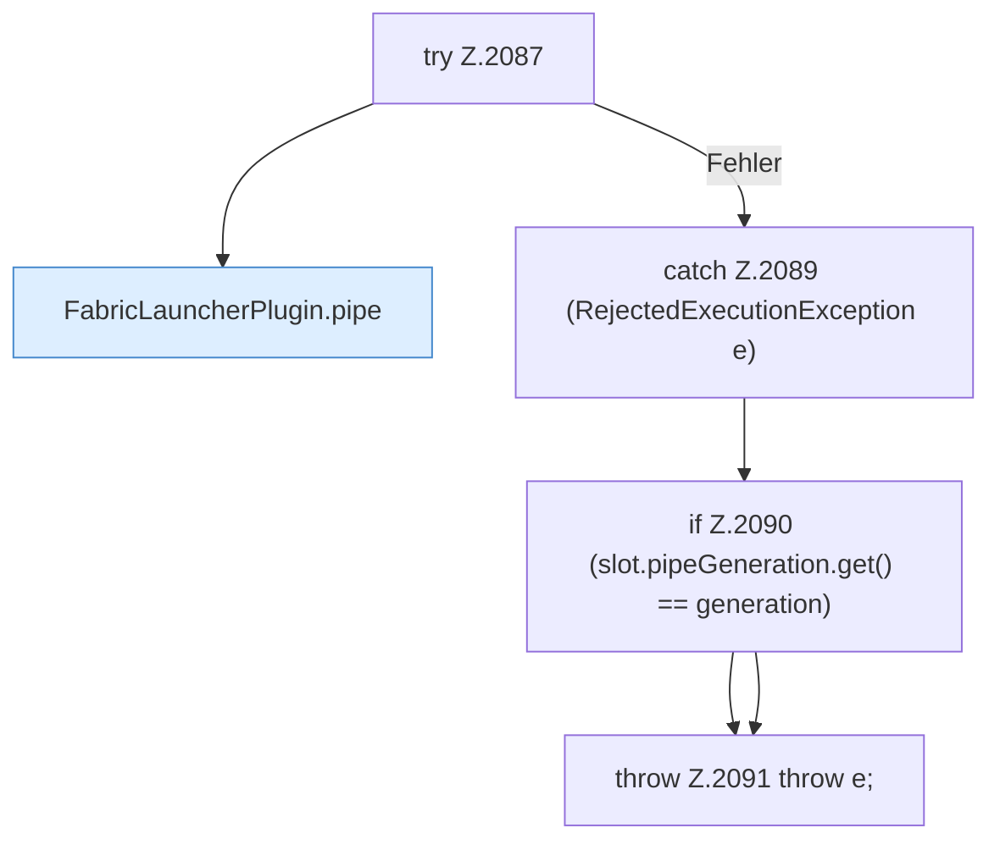

[[00 Start]] › [[Child-Prozess]] › [[Startablauf]] › [[FabricLauncherPlugin.armPipe]] › [[FabricLauncherPlugin.armPipe.Z2073.Teil2]]

# FabricLauncherPlugin.armPipe.Z2073.Teil2



```knoten
try Z.2087
  Zeile 2087: Versuch. Der Fehlerpfad geht in catch.
FabricLauncherPlugin.pipe
  Liest die [[Glossar#Konsole|Konsole]] [[Glossar#Zeile|Zeile]] für Zeile mit, bis das Programm endet. Liest eine Prozessausgabe `pipe`. Ruft `parseTick`, `add`, `trackPlayers`.
catch Z.2089 (RejectedExecutionException e)
  Zeile 2089: fängt (RejectedExecutionException e).
if Z.2090 (slot.pipeGeneration.get() == generation)
  Zeile 2090: prüft `(slot.pipeGeneration.get() == generation)`.
throw Z.2091 throw e;
  Zeile 2091: Abbruch `throw e;`.
```

> [!knoten]- Was die Blöcke tun
> - **try Z.2087**: Zeile 2087: Versuch. Der Fehlerpfad geht in catch.
> - **FabricLauncherPlugin.pipe**: Liest die [[Glossar#Konsole|Konsole]] [[Glossar#Zeile|Zeile]] für Zeile mit, bis das Programm endet. Liest eine Prozessausgabe `pipe`. Ruft `parseTick`, `add`, `trackPlayers`.
> - **catch Z.2089 (RejectedExecutionException e)**: Zeile 2089: fängt (RejectedExecutionException e).
> - **if Z.2090 (slot.pipeGeneration.get() == generation)**: Zeile 2090: prüft `(slot.pipeGeneration.get() == generation)`.
> - **throw Z.2091 throw e;**: Zeile 2091: Abbruch `throw e;`.

- Ein weiterer Abschnitt derselben Übersicht.
- Fortsetzung von `FabricLauncherPlugin.armPipe.Z2073`.
