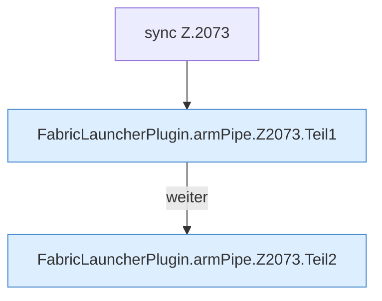

[[00 Start]] › [[Child-Prozess]] › [[Startablauf]] › [[FabricLauncherPlugin.armPipe]] › [[FabricLauncherPlugin.armPipe.Z2073]]

# FabricLauncherPlugin.armPipe.Z2073

- Fortsetzung von `FabricLauncherPlugin.armPipe`, Quellreihenfolge.
