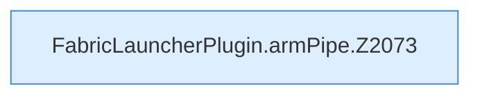

[[00 Start]] › [[Child-Prozess]] › [[Startablauf]] › [[FabricLauncherPlugin.armPipe]]

# FabricLauncherPlugin.armPipe

`FabricLauncherPlugin.armPipe(ChildSlot slot, Process process, String prefix)` [src/main/java/de/aichele/childlauncher/FabricLauncherPlugin.java:2073–2094](https://github.com/Sciddie/minecraft-serverhoster-plugin/blob/95b02b953b0b4c23673e900e021a7c3c844aa37d/src/main/java/de/aichele/childlauncher/FabricLauncherPlugin.java#L2073-L2094)



```knoten
FabricLauncherPlugin.armPipe.Z2073
  Der Ablauf geht in [[Glossar#Zeile|Zeile]] 2073 weiter. Eine Ebene tiefer steht er genauer. Im [[Glossar#Quelltext|Quelltext]] heißt das `Z2073`.
```

> [!knoten]- Was die Blöcke tun
> - **FabricLauncherPlugin.armPipe.Z2073**: Der Ablauf geht in [[Glossar#Zeile|Zeile]] 2073 weiter. Eine Ebene tiefer steht er genauer. Im [[Glossar#Quelltext|Quelltext]] heißt das `Z2073`.

- Schaltet das Mitlesen der [[Glossar#Konsole|Konsole]] an.
