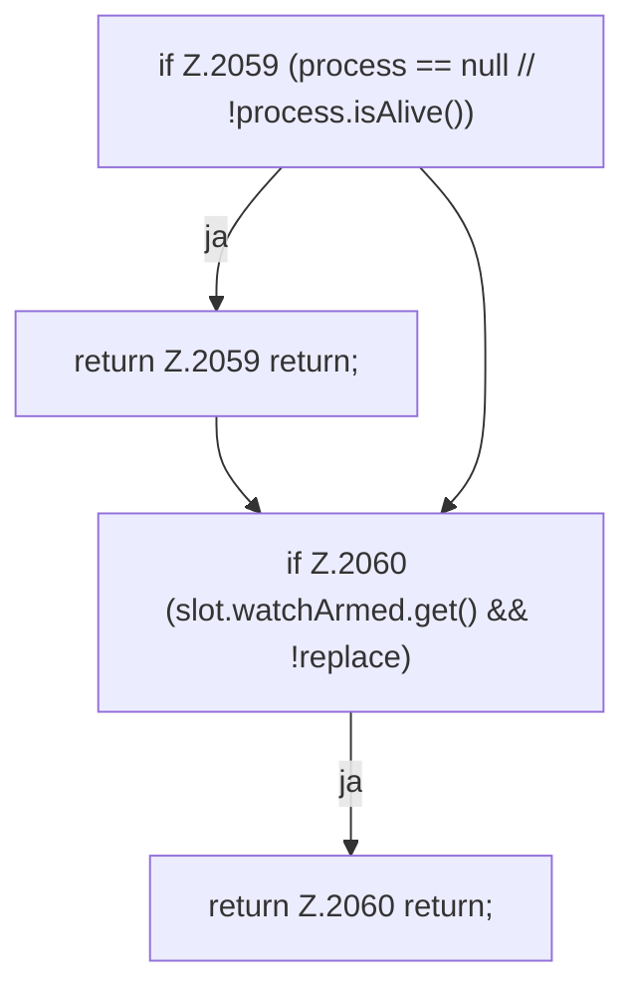

[[00 Start]] › [[Child-Prozess]] › [[Startablauf]] › [[FabricLauncherPlugin.armWatch]] › [[FabricLauncherPlugin.armWatch.Z2057.Teil1]]

# FabricLauncherPlugin.armWatch.Z2057.Teil1



```knoten
if Z.2059 (process == null // !process.isAlive())
  Zeile 2059: prüft `(process == null // !process.isAlive())`.
return Z.2059 return;
  Zeile 2059: Rückgabe `return;`.
if Z.2060 (slot.watchArmed.get() && !replace)
  Zeile 2060: prüft `(slot.watchArmed.get() && !replace)`.
return Z.2060 return;
  Zeile 2060: Rückgabe `return;`.
```

- Fortsetzung von `FabricLauncherPlugin.armWatch.Z2057`, Quellreihenfolge.
