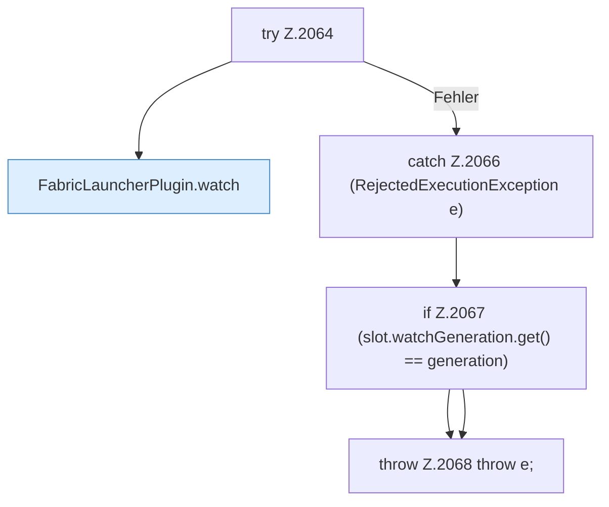

[[00 Start]] › [[Child-Prozess]] › [[Startablauf]] › [[FabricLauncherPlugin.armWatch]] › [[FabricLauncherPlugin.armWatch.Z2057.Teil2]]

# FabricLauncherPlugin.armWatch.Z2057.Teil2



```knoten
try Z.2064
  Zeile 2064: Versuch. Der Fehlerpfad geht in catch.
FabricLauncherPlugin.watch
  Liest die Ausgabe bis zum Ende `watch`. Ruft `armWatch`, `add`, `deleteIfMatch`.
catch Z.2066 (RejectedExecutionException e)
  Zeile 2066: fängt (RejectedExecutionException e).
if Z.2067 (slot.watchGeneration.get() == generation)
  Zeile 2067: prüft `(slot.watchGeneration.get() == generation)`.
throw Z.2068 throw e;
  Zeile 2068: Abbruch `throw e;`.
```

- Fortsetzung von `FabricLauncherPlugin.armWatch.Z2057`, Quellreihenfolge.
