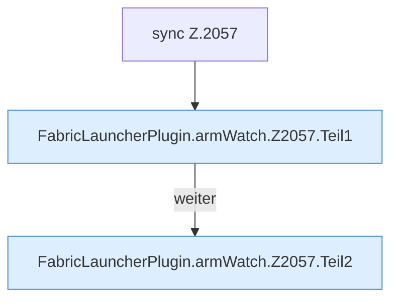

[[00 Start]] › [[Child-Prozess]] › [[Startablauf]] › [[FabricLauncherPlugin.armWatch]] › [[FabricLauncherPlugin.armWatch.Z2057]]

# FabricLauncherPlugin.armWatch.Z2057

- Fortsetzung von `FabricLauncherPlugin.armWatch`, Quellreihenfolge.
