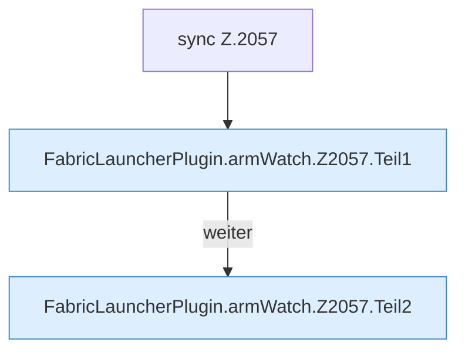

[[00 Start]] › [[Child-Prozess]] › [[Startablauf]] › [[FabricLauncherPlugin.armWatch]] › [[FabricLauncherPlugin.armWatch.Z2057]]

# FabricLauncherPlugin.armWatch.Z2057



```knoten
sync Z.2057
  Zeile 2057: synchronisierter Block.
FabricLauncherPlugin.armWatch.Z2057.Teil1
  Abschnitt 1 dieses Ablaufs, in Quellreihenfolge.
FabricLauncherPlugin.armWatch.Z2057.Teil2
  Abschnitt 2 dieses Ablaufs, in Quellreihenfolge.
```

- Fortsetzung von `FabricLauncherPlugin.armWatch`, Quellreihenfolge.
