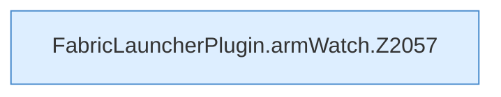

[[00 Start]] › [[Child-Prozess]] › [[Startablauf]] › [[FabricLauncherPlugin.armWatch]]

# FabricLauncherPlugin.armWatch

`FabricLauncherPlugin.armWatch(ChildSlot slot, Process process, boolean replace)` [src/main/java/de/aichele/childlauncher/FabricLauncherPlugin.java:2057–2071](https://github.com/Sciddie/minecraft-serverhoster-plugin/blob/95b02b953b0b4c23673e900e021a7c3c844aa37d/src/main/java/de/aichele/childlauncher/FabricLauncherPlugin.java#L2057-L2071)



```knoten
FabricLauncherPlugin.armWatch.Z2057
  Der Ablauf geht in [[Glossar#Zeile|Zeile]] 2057 weiter. Eine Ebene tiefer steht er genauer. Im [[Glossar#Quelltext|Quelltext]] heißt das `Z2057`.
```

> [!knoten]- Was die Blöcke tun
> - **FabricLauncherPlugin.armWatch.Z2057**: Der Ablauf geht in [[Glossar#Zeile|Zeile]] 2057 weiter. Eine Ebene tiefer steht er genauer. Im [[Glossar#Quelltext|Quelltext]] heißt das `Z2057`.

- Schaltet die [[Glossar#Aufsicht|Aufsicht]] an, die merkt, wenn das Programm endet.
