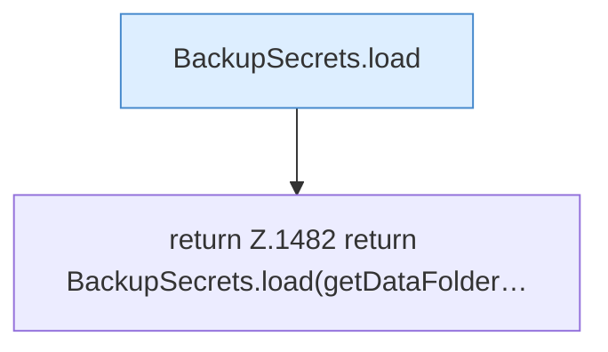

[[00 Start]] › [[Backup]] › [[Backup-Lauf]] › [[FabricLauncherPlugin.backupCredentials]]

# FabricLauncherPlugin.backupCredentials

`FabricLauncherPlugin.backupCredentials()` [src/main/java/de/aichele/childlauncher/FabricLauncherPlugin.java:1481–1483](https://github.com/Sciddie/minecraft-serverhoster-plugin/blob/95b02b953b0b4c23673e900e021a7c3c844aa37d/src/main/java/de/aichele/childlauncher/FabricLauncherPlugin.java#L1481-L1483)

- `backupCredentials` in `src/main/java/de/aichele/childlauncher/FabricLauncherPlugin.java`
