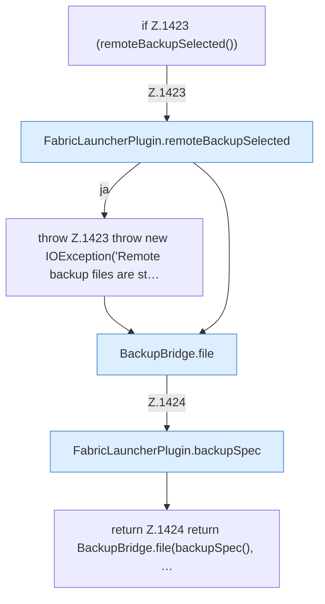

[[00 Start]] › [[Backup]] › [[Backup-Dateien]] › [[FabricLauncherPlugin.backupFile]]

# FabricLauncherPlugin.backupFile

`FabricLauncherPlugin.backupFile(String id, String name)` [src/main/java/de/aichele/childlauncher/FabricLauncherPlugin.java:1422–1425](https://github.com/Sciddie/minecraft-serverhoster-plugin/blob/95b02b953b0b4c23673e900e021a7c3c844aa37d/src/main/java/de/aichele/childlauncher/FabricLauncherPlugin.java#L1422-L1425)



```knoten
if Z.1423 (remoteBackupSelected())
  Zeile 1423: prüft `(remoteBackupSelected())`.
FabricLauncherPlugin.remoteBackupSelected
  `remoteBackupSelected` in `FabricLauncherPlugin.java`.
throw Z.1423 throw new IOException('Remote backup files are st…
  Zeile 1423: Abbruch `throw new IOException('Remote backup files are st…`.
BackupBridge.file
  Liefert die Datei `file`. Ruft `safeId`, `named`, `directory`.
FabricLauncherPlugin.backupSpec
  Sichert `backupSpec`.
return Z.1424 return BackupBridge.file(backupSpec(), …
  Zeile 1424: Rückgabe `return BackupBridge.file(backupSpec(), …`.
```

- `backupFile` in `src/main/java/de/aichele/childlauncher/FabricLauncherPlugin.java`
- Befund: toter Code, sicher. src/main/java/de/aichele/childlauncher/FabricLauncherPlugin.java:1422–1425 kein Aufruf, kein Treffer in plugin.yml/UI/Strings
