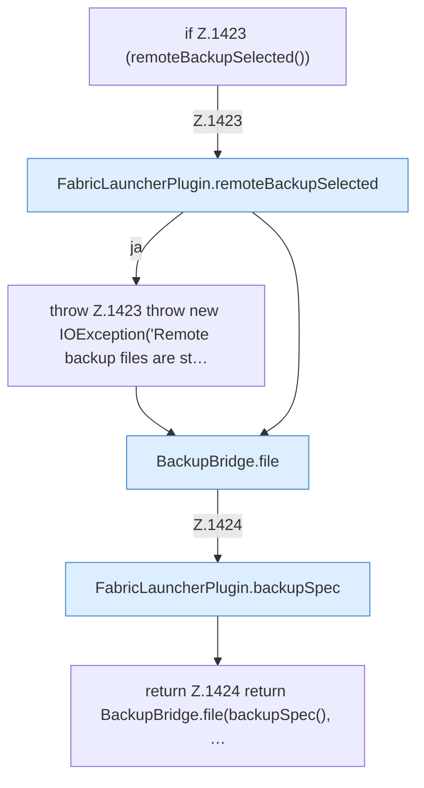

[[00 Start]] › [[Backup]] › [[Backup-Dateien]] › [[FabricLauncherPlugin.backupFile]]

# FabricLauncherPlugin.backupFile

`FabricLauncherPlugin.backupFile(String id, String name)` [src/main/java/de/aichele/childlauncher/FabricLauncherPlugin.java:1422–1425](https://github.com/Sciddie/minecraft-serverhoster-plugin/blob/95b02b953b0b4c23673e900e021a7c3c844aa37d/src/main/java/de/aichele/childlauncher/FabricLauncherPlugin.java#L1422-L1425)



```knoten
if Z.1423 (remoteBackupSelected())
  Hier fällt eine Entscheidung. Nur wenn sie zutrifft, geht es den Ja-Weg weiter. Das steht in [[Glossar#Zeile|Zeile]] 1423.
FabricLauncherPlugin.remoteBackupSelected
  Das [[Glossar#Plugin|Plugin]] sichert die Auswahl. Im [[Glossar#Quelltext|Quelltext]] heißt das `remoteBackupSelected`.
throw Z.1423 throw new IOException('Remote backup files are st…
  Hier bricht die [[Glossar#Funktion|Funktion]] ab, weil etwas nicht geklappt hat. Das steht in [[Glossar#Zeile|Zeile]] 1423.
BackupBridge.file
  Die Sicherung auf diesem Rechner macht hier einen einzelnen Schritt. Eine Ebene tiefer steht er genauer. Im [[Glossar#Quelltext|Quelltext]] heißt das `file`.
FabricLauncherPlugin.backupSpec
  Das [[Glossar#Plugin|Plugin]] sichert die Vorgabe. Im [[Glossar#Quelltext|Quelltext]] heißt das `backupSpec`.
return Z.1424 return BackupBridge.file(backupSpec(), …
  Hier endet die [[Glossar#Funktion|Funktion]] und liefert ein Ergebnis zurück. Das steht in [[Glossar#Zeile|Zeile]] 1424.
```

> [!knoten]- Was die Blöcke tun
> - **if Z.1423 (remoteBackupSelected())**: Hier fällt eine Entscheidung. Nur wenn sie zutrifft, geht es den Ja-Weg weiter. Das steht in [[Glossar#Zeile|Zeile]] 1423.
> - **FabricLauncherPlugin.remoteBackupSelected**: Das [[Glossar#Plugin|Plugin]] sichert die Auswahl. Im [[Glossar#Quelltext|Quelltext]] heißt das `remoteBackupSelected`.
> - **throw Z.1423 throw new IOException('Remote backup files are st…**: Hier bricht die [[Glossar#Funktion|Funktion]] ab, weil etwas nicht geklappt hat. Das steht in [[Glossar#Zeile|Zeile]] 1423.
> - **BackupBridge.file**: Die Sicherung auf diesem Rechner macht hier einen einzelnen Schritt. Eine Ebene tiefer steht er genauer. Im [[Glossar#Quelltext|Quelltext]] heißt das `file`.
> - **FabricLauncherPlugin.backupSpec**: Das [[Glossar#Plugin|Plugin]] sichert die Vorgabe. Im [[Glossar#Quelltext|Quelltext]] heißt das `backupSpec`.
> - **return Z.1424 return BackupBridge.file(backupSpec(), …**: Hier endet die [[Glossar#Funktion|Funktion]] und liefert ein Ergebnis zurück. Das steht in [[Glossar#Zeile|Zeile]] 1424.

- Das [[Glossar#Plugin|Plugin]] sichert die Datei.
- Auffällig: im normalen Betrieb ruft das niemand auf. Das nennt man [[Glossar#Ungenutzt|Ungenutzt]].
