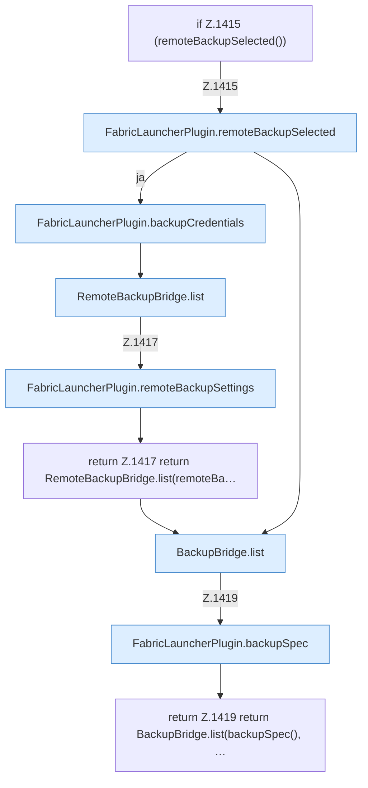

[[00 Start]] › [[Backup]] › [[Backup-Dateien]] › [[FabricLauncherPlugin.backupFiles]]

# FabricLauncherPlugin.backupFiles

`FabricLauncherPlugin.backupFiles(String id)` [src/main/java/de/aichele/childlauncher/FabricLauncherPlugin.java:1414–1420](https://github.com/Sciddie/minecraft-serverhoster-plugin/blob/95b02b953b0b4c23673e900e021a7c3c844aa37d/src/main/java/de/aichele/childlauncher/FabricLauncherPlugin.java#L1414-L1420)

- `backupFiles` in `src/main/java/de/aichele/childlauncher/FabricLauncherPlugin.java`
