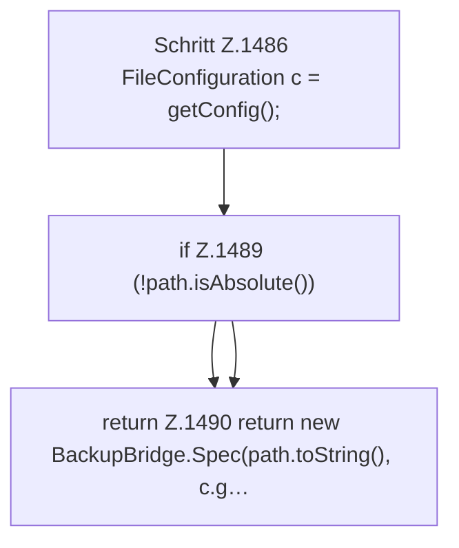

[[00 Start]] › [[Backup]] › [[Backup-Lauf]] › [[FabricLauncherPlugin.backupSpec]]

# FabricLauncherPlugin.backupSpec

`FabricLauncherPlugin.backupSpec()` [src/main/java/de/aichele/childlauncher/FabricLauncherPlugin.java:1485–1495](https://github.com/Sciddie/minecraft-serverhoster-plugin/blob/95b02b953b0b4c23673e900e021a7c3c844aa37d/src/main/java/de/aichele/childlauncher/FabricLauncherPlugin.java#L1485-L1495)



```knoten
Schritt Z.1486 FileConfiguration c = getConfig();
  Zeile 1486: liest die Config. `FileConfiguration c = getConfig();`
if Z.1489 (!path.isAbsolute())
  Zeile 1489: prüft `(!path.isAbsolute())`.
return Z.1490 return new BackupBridge.Spec(path.toString(), c.g…
  Zeile 1490: Rückgabe `return new BackupBridge.Spec(path.toString(), c.g…`.
```

- `backupSpec` in `src/main/java/de/aichele/childlauncher/FabricLauncherPlugin.java`
