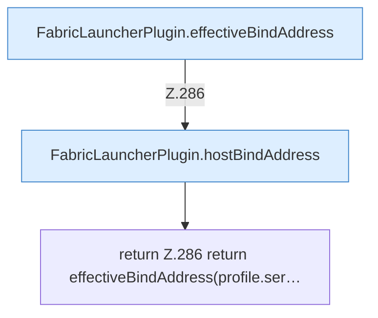

[[00 Start]] › [[Plugin-Kern]] › [[Bind-Adresse]] › [[FabricLauncherPlugin.childBindAddress]]

# FabricLauncherPlugin.childBindAddress

`FabricLauncherPlugin.childBindAddress(ServerProfile profile)` [src/main/java/de/aichele/childlauncher/FabricLauncherPlugin.java:285–287](https://github.com/Sciddie/minecraft-serverhoster-plugin/blob/95b02b953b0b4c23673e900e021a7c3c844aa37d/src/main/java/de/aichele/childlauncher/FabricLauncherPlugin.java#L285-L287)



```knoten
FabricLauncherPlugin.effectiveBindAddress
  Liefert den wirksamen Wert `effectiveBindAddress`.
FabricLauncherPlugin.hostBindAddress
  Betrifft den Host `hostBindAddress`.
return Z.286 return effectiveBindAddress(profile.ser…
  Zeile 286: Rückgabe `return effectiveBindAddress(profile.ser…`.
```

- `childBindAddress` in `src/main/java/de/aichele/childlauncher/FabricLauncherPlugin.java`
