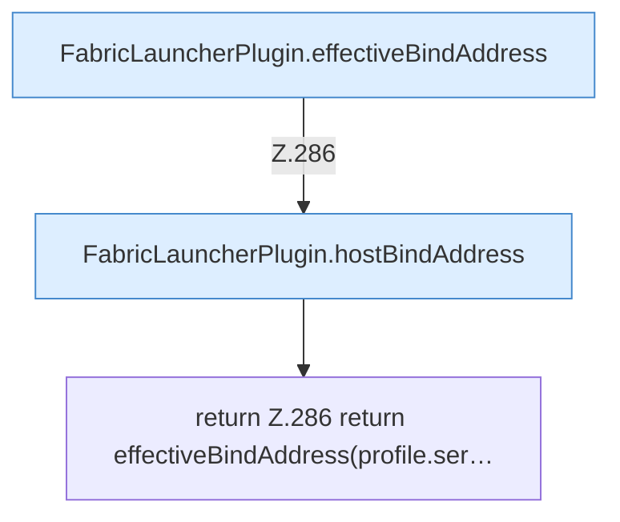

[[00 Start]] › [[Plugin-Kern]] › [[Bind-Adresse]] › [[FabricLauncherPlugin.childBindAddress]]

# FabricLauncherPlugin.childBindAddress

`FabricLauncherPlugin.childBindAddress(ServerProfile profile)` [src/main/java/de/aichele/childlauncher/FabricLauncherPlugin.java:285–287](https://github.com/Sciddie/minecraft-serverhoster-plugin/blob/95b02b953b0b4c23673e900e021a7c3c844aa37d/src/main/java/de/aichele/childlauncher/FabricLauncherPlugin.java#L285-L287)



```knoten
FabricLauncherPlugin.effectiveBindAddress
  Die Adresse, die nach allen Ersatzregeln wirklich gilt. Im [[Glossar#Quelltext|Quelltext]] heißt das `effectiveBindAddress`.
FabricLauncherPlugin.hostBindAddress
  Die Adresse, unter der der [[Glossar#Host|Host]] selbst erreichbar sein soll. Im [[Glossar#Quelltext|Quelltext]] heißt das `hostBindAddress`.
return Z.286 return effectiveBindAddress(profile.ser…
  Hier endet die [[Glossar#Funktion|Funktion]] und liefert ein Ergebnis zurück. Das steht in [[Glossar#Zeile|Zeile]] 286.
```

> [!knoten]- Was die Blöcke tun
> - **FabricLauncherPlugin.effectiveBindAddress**: Die Adresse, die nach allen Ersatzregeln wirklich gilt. Im [[Glossar#Quelltext|Quelltext]] heißt das `effectiveBindAddress`.
> - **FabricLauncherPlugin.hostBindAddress**: Die Adresse, unter der der [[Glossar#Host|Host]] selbst erreichbar sein soll. Im [[Glossar#Quelltext|Quelltext]] heißt das `hostBindAddress`.
> - **return Z.286 return effectiveBindAddress(profile.ser…**: Hier endet die [[Glossar#Funktion|Funktion]] und liefert ein Ergebnis zurück. Das steht in [[Glossar#Zeile|Zeile]] 286.

- Die Adresse, unter der der [[Glossar#Spielserver|Spielserver]] erreichbar sein soll.
