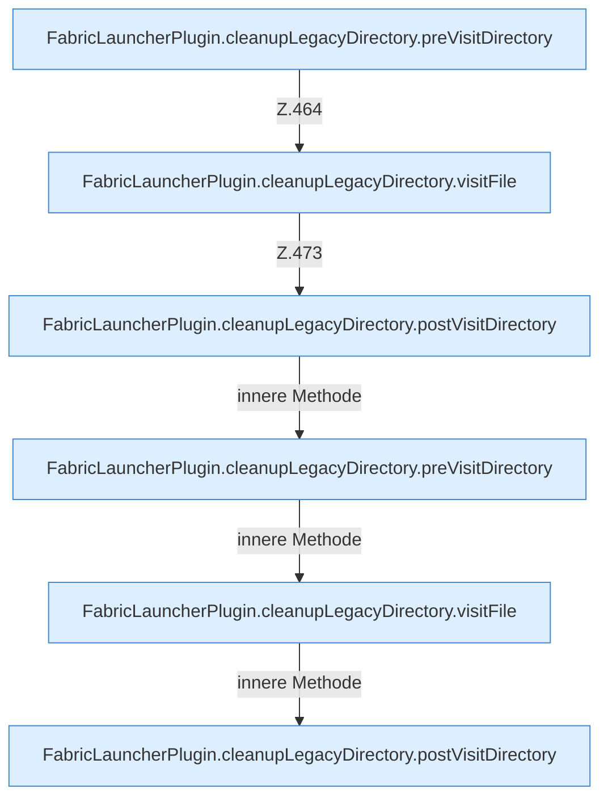

[[00 Start]] › [[Plugin-Kern]] › [[Setup]] › [[Setup-Aufraeumen]] › [[FabricLauncherPlugin.cleanupLegacyDirectory]]

# FabricLauncherPlugin.cleanupLegacyDirectory

`FabricLauncherPlugin.cleanupLegacyDirectory(Path oldData, Set<Path> preserved)` [src/main/java/de/aichele/childlauncher/FabricLauncherPlugin.java:450–485](https://github.com/Sciddie/minecraft-serverhoster-plugin/blob/95b02b953b0b4c23673e900e021a7c3c844aa37d/src/main/java/de/aichele/childlauncher/FabricLauncherPlugin.java#L450-L485)

- `cleanupLegacyDirectory` in `src/main/java/de/aichele/childlauncher/FabricLauncherPlugin.java`
