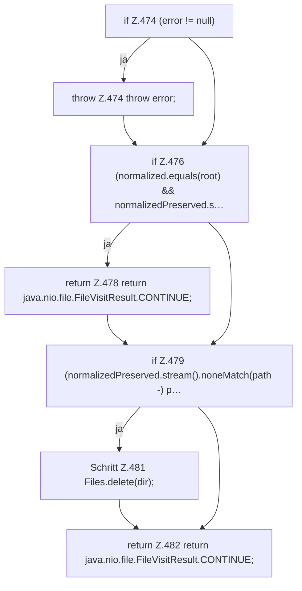

[[00 Start]] › [[Plugin-Kern]] › [[Setup]] › [[Setup-Aufraeumen]] › [[FabricLauncherPlugin.cleanupLegacyDirectory]] › [[FabricLauncherPlugin.cleanupLegacyDirectory.postVisitDirectory]]

# FabricLauncherPlugin.cleanupLegacyDirectory.postVisitDirectory

`FabricLauncherPlugin.postVisitDirectory(Path dir, IOException error)` [src/main/java/de/aichele/childlauncher/FabricLauncherPlugin.java:473–483](https://github.com/Sciddie/minecraft-serverhoster-plugin/blob/95b02b953b0b4c23673e900e021a7c3c844aa37d/src/main/java/de/aichele/childlauncher/FabricLauncherPlugin.java#L473-L483)



```knoten
if Z.474 (error != null)
  Zeile 474: prüft `(error != null)`.
throw Z.474 throw error;
  Zeile 474: Abbruch `throw error;`.
if Z.476 (normalized.equals(root) && normalizedPreserved.s…
  Zeile 476: prüft `(normalized.equals(root) && normalizedPreserved.s…`.
return Z.478 return java.nio.file.FileVisitResult.CONTINUE;
  Zeile 478: Rückgabe `return java.nio.file.FileVisitResult.CONTINUE;`.
if Z.479 (normalizedPreserved.stream().noneMatch(path -) p…
  Zeile 479: prüft `(normalizedPreserved.stream().noneMatch(path -) p…`.
Schritt Z.481 Files.delete(dir);
  Zeile 481: Dateioperation. `Files.delete(dir);`
return Z.482 return java.nio.file.FileVisitResult.CONTINUE;
  Zeile 482: Rückgabe `return java.nio.file.FileVisitResult.CONTINUE;`.
```

> [!knoten]- Was die Blöcke tun
> - **if Z.474 (error != null)**: Zeile 474: prüft `(error != null)`.
> - **throw Z.474 throw error;**: Zeile 474: Abbruch `throw error;`.
> - **if Z.476 (normalized.equals(root) && normalizedPreserved.s…**: Zeile 476: prüft `(normalized.equals(root) && normalizedPreserved.s…`.
> - **return Z.478 return java.nio.file.FileVisitResult.CONTINUE;**: Zeile 478: Rückgabe `return java.nio.file.FileVisitResult.CONTINUE;`.
> - **if Z.479 (normalizedPreserved.stream().noneMatch(path -) p…**: Zeile 479: prüft `(normalizedPreserved.stream().noneMatch(path -) p…`.
> - **Schritt Z.481 Files.delete(dir);**: Zeile 481: Dateioperation. `Files.delete(dir);`
> - **return Z.482 return java.nio.file.FileVisitResult.CONTINUE;**: Zeile 482: Rückgabe `return java.nio.file.FileVisitResult.CONTINUE;`.

- Das [[Glossar#Plugin|Plugin]] schickt hier einen Schritt. Eine Ebene tiefer steht er genauer.
- `postVisitDirectory` in `src/main/java/de/aichele/childlauncher/FabricLauncherPlugin.java`
