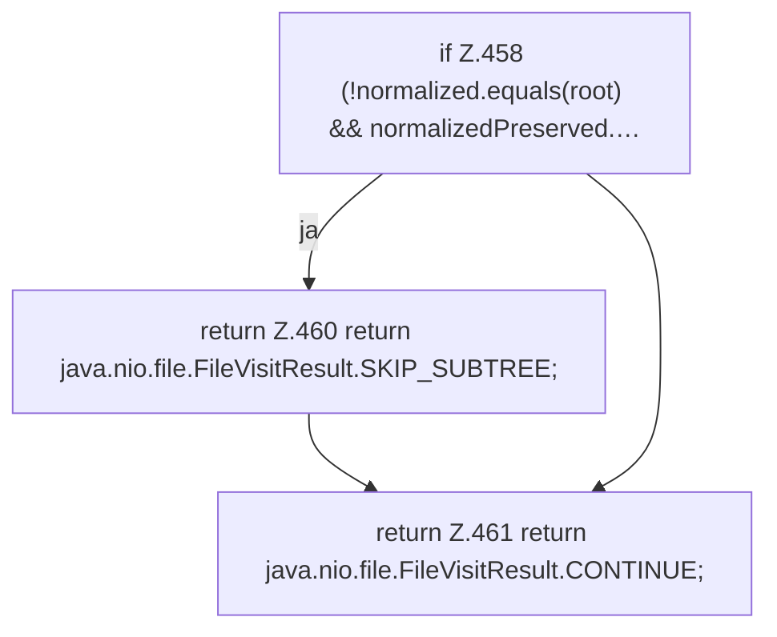

[[00 Start]] › [[Plugin-Kern]] › [[Setup]] › [[Setup-Aufraeumen]] › [[FabricLauncherPlugin.cleanupLegacyDirectory]] › [[FabricLauncherPlugin.cleanupLegacyDirectory.preVisitDirectory]]

# FabricLauncherPlugin.cleanupLegacyDirectory.preVisitDirectory

`FabricLauncherPlugin.preVisitDirectory(Path dir, java.nio.file.attribute.BasicFileAttributes attrs)` [src/main/java/de/aichele/childlauncher/FabricLauncherPlugin.java:455–462](https://github.com/Sciddie/minecraft-serverhoster-plugin/blob/95b02b953b0b4c23673e900e021a7c3c844aa37d/src/main/java/de/aichele/childlauncher/FabricLauncherPlugin.java#L455-L462)



```knoten
if Z.458 (!normalized.equals(root) && normalizedPreserved.…
  Zeile 458: prüft `(!normalized.equals(root) && normalizedPreserved.…`.
return Z.460 return java.nio.file.FileVisitResult.SKIP_SUBTREE;
  Zeile 460: Rückgabe `return java.nio.file.FileVisitResult.SKIP_SUBTREE;`.
return Z.461 return java.nio.file.FileVisitResult.CONTINUE;
  Zeile 461: Rückgabe `return java.nio.file.FileVisitResult.CONTINUE;`.
```

> [!knoten]- Was die Blöcke tun
> - **if Z.458 (!normalized.equals(root) && normalizedPreserved.…**: Zeile 458: prüft `(!normalized.equals(root) && normalizedPreserved.…`.
> - **return Z.460 return java.nio.file.FileVisitResult.SKIP_SUBTREE;**: Zeile 460: Rückgabe `return java.nio.file.FileVisitResult.SKIP_SUBTREE;`.
> - **return Z.461 return java.nio.file.FileVisitResult.CONTINUE;**: Zeile 461: Rückgabe `return java.nio.file.FileVisitResult.CONTINUE;`.

- Das [[Glossar#Plugin|Plugin]] macht hier einen einzelnen Schritt. Eine Ebene tiefer steht er genauer.
- `preVisitDirectory` in `src/main/java/de/aichele/childlauncher/FabricLauncherPlugin.java`
