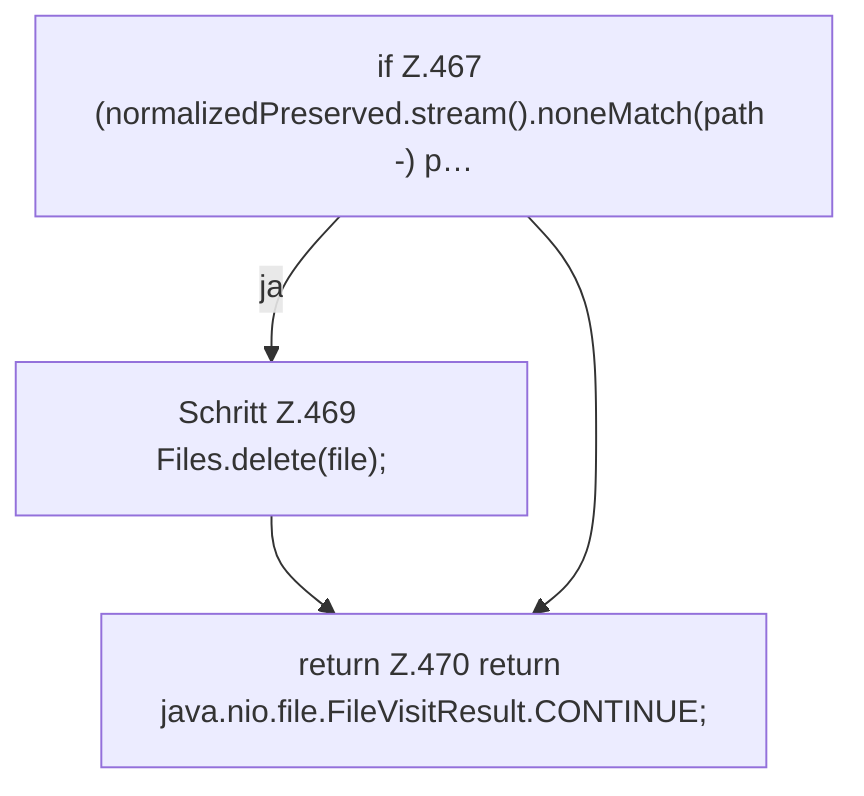

[[00 Start]] › [[Plugin-Kern]] › [[Setup]] › [[Setup-Aufraeumen]] › [[FabricLauncherPlugin.cleanupLegacyDirectory]] › [[FabricLauncherPlugin.cleanupLegacyDirectory.visitFile]]

# FabricLauncherPlugin.cleanupLegacyDirectory.visitFile

`FabricLauncherPlugin.visitFile(Path file, java.nio.file.attribute.BasicFileAttributes attrs)` [src/main/java/de/aichele/childlauncher/FabricLauncherPlugin.java:464–471](https://github.com/Sciddie/minecraft-serverhoster-plugin/blob/95b02b953b0b4c23673e900e021a7c3c844aa37d/src/main/java/de/aichele/childlauncher/FabricLauncherPlugin.java#L464-L471)

- `visitFile` in `src/main/java/de/aichele/childlauncher/FabricLauncherPlugin.java`
