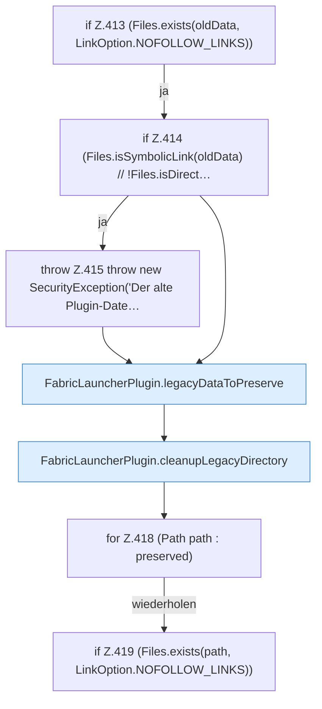

[[00 Start]] › [[Plugin-Kern]] › [[Setup]] › [[Setup-Aufraeumen]] › [[FabricLauncherPlugin.cleanupLegacyFiles]] › [[FabricLauncherPlugin.cleanupLegacyFiles.Z413]]

# FabricLauncherPlugin.cleanupLegacyFiles.Z413

- Fortsetzung von `FabricLauncherPlugin.cleanupLegacyFiles`, Quellreihenfolge.
