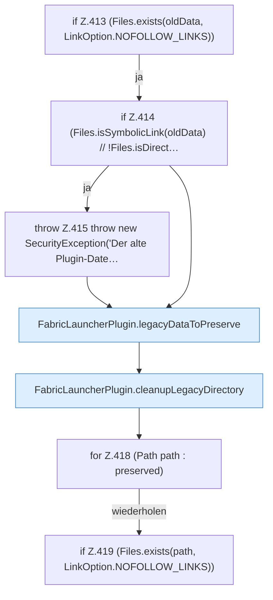

[[00 Start]] › [[Plugin-Kern]] › [[Setup]] › [[Setup-Aufraeumen]] › [[FabricLauncherPlugin.cleanupLegacyFiles]] › [[FabricLauncherPlugin.cleanupLegacyFiles.Z413]]

# FabricLauncherPlugin.cleanupLegacyFiles.Z413



```knoten
if Z.413 (Files.exists(oldData, LinkOption.NOFOLLOW_LINKS))
  Zeile 413: prüft `(Files.exists(oldData, LinkOption.NOFOLLOW_LINKS))`.
if Z.414 (Files.isSymbolicLink(oldData) // !Files.isDirect…
  Zeile 414: prüft `(Files.isSymbolicLink(oldData) // !Files.isDirect…`.
throw Z.415 throw new SecurityException('Der alte Plugin-Date…
  Zeile 415: Abbruch `throw new SecurityException('Der alte Plugin-Date…`.
FabricLauncherPlugin.legacyDataToPreserve
  Das [[Glossar#Plugin|Plugin]] macht hier einen einzelnen Schritt. Eine Ebene tiefer steht er genauer. `legacyDataToPreserve` in `FabricLauncherPlugin.java`. Ruft `addLegacyDataToPreserve`.
FabricLauncherPlugin.cleanupLegacyDirectory
  Das [[Glossar#Plugin|Plugin]] räumt auf den alten Weg. Räumt auf `cleanupLegacyDirectory`. Ruft `preVisitDirectory`, `visitFile`, `postVisitDirectory`.
for Z.418 (Path path : preserved)
  Zeile 418: Schleife `(Path path : preserved)`.
if Z.419 (Files.exists(path, LinkOption.NOFOLLOW_LINKS))
  Zeile 419: prüft `(Files.exists(path, LinkOption.NOFOLLOW_LINKS))`.
```

> [!knoten]- Was die Blöcke tun
> - **if Z.413 (Files.exists(oldData, LinkOption.NOFOLLOW_LINKS))**: Zeile 413: prüft `(Files.exists(oldData, LinkOption.NOFOLLOW_LINKS))`.
> - **if Z.414 (Files.isSymbolicLink(oldData) // !Files.isDirect…**: Zeile 414: prüft `(Files.isSymbolicLink(oldData) // !Files.isDirect…`.
> - **throw Z.415 throw new SecurityException('Der alte Plugin-Date…**: Zeile 415: Abbruch `throw new SecurityException('Der alte Plugin-Date…`.
> - **FabricLauncherPlugin.legacyDataToPreserve**: Das [[Glossar#Plugin|Plugin]] macht hier einen einzelnen Schritt. Eine Ebene tiefer steht er genauer. `legacyDataToPreserve` in `FabricLauncherPlugin.java`. Ruft `addLegacyDataToPreserve`.
> - **FabricLauncherPlugin.cleanupLegacyDirectory**: Das [[Glossar#Plugin|Plugin]] räumt auf den alten Weg. Räumt auf `cleanupLegacyDirectory`. Ruft `preVisitDirectory`, `visitFile`, `postVisitDirectory`.
> - **for Z.418 (Path path : preserved)**: Zeile 418: Schleife `(Path path : preserved)`.
> - **if Z.419 (Files.exists(path, LinkOption.NOFOLLOW_LINKS))**: Zeile 419: prüft `(Files.exists(path, LinkOption.NOFOLLOW_LINKS))`.

- Der Ablauf geht in [[Glossar#Zeile|Zeile]] 413 weiter. Eine Ebene tiefer steht er genauer.
- Fortsetzung von `FabricLauncherPlugin.cleanupLegacyFiles`.
