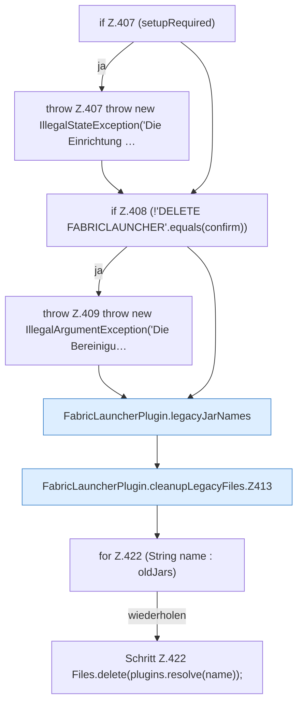

[[00 Start]] › [[Plugin-Kern]] › [[Setup]] › [[Setup-Aufraeumen]] › [[FabricLauncherPlugin.cleanupLegacyFiles]]

# FabricLauncherPlugin.cleanupLegacyFiles

`FabricLauncherPlugin.cleanupLegacyFiles(String confirm)` [src/main/java/de/aichele/childlauncher/FabricLauncherPlugin.java:406–423](https://github.com/Sciddie/minecraft-serverhoster-plugin/blob/95b02b953b0b4c23673e900e021a7c3c844aa37d/src/main/java/de/aichele/childlauncher/FabricLauncherPlugin.java#L406-L423)



```knoten
if Z.407 (setupRequired)
  Zeile 407: prüft `(setupRequired)`.
throw Z.407 throw new IllegalStateException('Die Einrichtung …
  Zeile 407: Abbruch `throw new IllegalStateException('Die Einrichtung …`.
if Z.408 (!'DELETE FABRICLAUNCHER'.equals(confirm))
  Zeile 408: prüft `(!'DELETE FABRICLAUNCHER'.equals(confirm))`.
throw Z.409 throw new IllegalArgumentException('Die Bereinigu…
  Zeile 409: Abbruch `throw new IllegalArgumentException('Die Bereinigu…`.
FabricLauncherPlugin.legacyJarNames
  `legacyJarNames` in `FabricLauncherPlugin.java`.
FabricLauncherPlugin.cleanupLegacyFiles.Z413
  Fortsetzung des Ablaufs ab Zeile 413.
for Z.422 (String name : oldJars)
  Zeile 422: Schleife `(String name : oldJars)`.
Schritt Z.422 Files.delete(plugins.resolve(name));
  Zeile 422: Dateioperation. `Files.delete(plugins.resolve(name));`
```

- `cleanupLegacyFiles` in `src/main/java/de/aichele/childlauncher/FabricLauncherPlugin.java`
